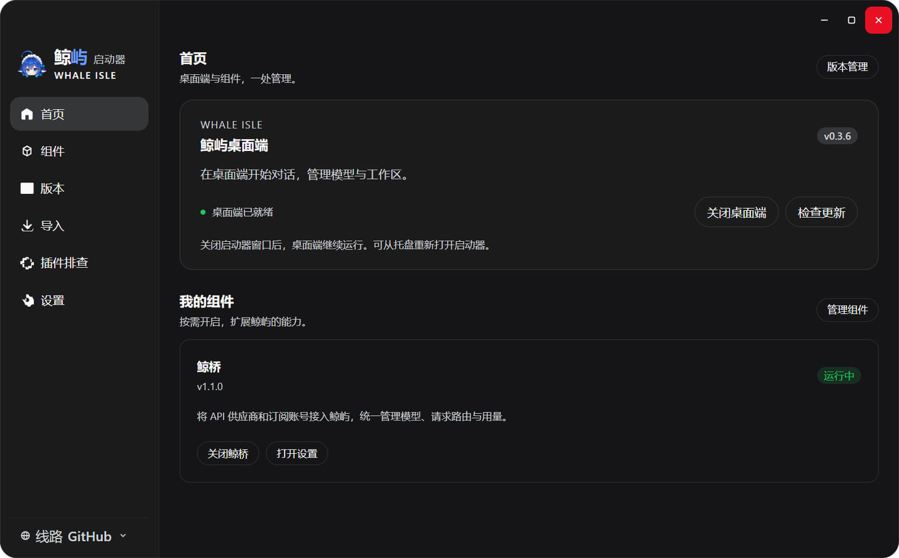

<p align="center">
  
</p>

<h1 align="center">Whale Isle</h1>

<p align="center">
  An open-source community desktop client built on DeepSeek Harness<br />
  AI conversations, file previews, terminal and Git in one window.
</p>

<p align="center">
  <a href="README.md">中文</a> · English ·
  <a href="https://github.com/ChisaAlter/WhaleIsle/releases/latest">Download</a> ·
  <a href="https://cnb.cool/ayasealter/WhaleIsle/-/releases">CNB mirror</a> ·
  <a href="https://github.com/ChisaAlter/WhaleIsle/issues">Report an issue</a>
</p>

<p align="center">
  <a href="https://github.com/ChisaAlter/WhaleIsle/releases/latest"></a>
  <a href="LICENSE"></a>
  
  
</p>

<p align="center">
  
</p>

Independently maintained by the community, not an official DeepSeek product. Built on [DeepSeek Harness](https://github.com/deepseek-ai/deepseek-harness), with AI conversations, tool calls, Agent Teams, MCP, skills and plugins.

## Download and get started

| Platform | v0.3.6 |
| --- | --- |
| Windows 10+ · x64 | [Download installer](https://github.com/ChisaAlter/WhaleIsle/releases/download/v0.3.6/Whale-Isle-Setup-0.3.6.exe) |
| macOS 14+ · Apple Silicon | [Download ARM64 DMG](https://github.com/ChisaAlter/WhaleIsle/releases/download/v0.3.6/Whale-Isle-0.3.6-mac-arm64.dmg) |

[CNB mirror](https://cnb.cool/ayasealter/WhaleIsle/-/releases/tag/v0.3.6) · [Full release notes](https://github.com/ChisaAlter/WhaleIsle/releases/tag/v0.3.6)

The Windows package is unsigned. The Mac package is unsigned and not notarized, and does not include the Windows-only bundled Office runtime. The release page provides `SHA512SUMS.txt` for integrity checks.

1. Install and open the app.
2. Configure an API service in Settings → Models. Windows users can also install WhaleBridge from the launcher and add providers or subscription accounts.
3. Choose a workspace directory or start a conversation without a workspace. Model fees are charged by your provider; this project does not supply model credits.

## What's new in v0.3.6

- Next-prompt suggestions: click or press Tab to fill the draft without sending it. Enabled by default and can be turned off; generation makes an additional model call.
- Fixes for cleanup after message re-editing, repeated exit confirmations and launcher spacing.
- A Mac ARM64 package with native traffic-light buttons and fullscreen support.

## Features

- **Conversations and collaboration**: Workspaces and chat history, tool calls and approvals, message editing, Agent Teams and next-prompt suggestions.
- **Files, terminal and Git**: Search and edit files, preview web pages and diffs, run commands, switch branches, commit and push.
- **Models and extensions**: API services, MCP, skills, the plugin marketplace and optional WhaleBridge model access on Windows.
- **Appearance and whale-girl**: Light, dark and transparent themes, wallpapers, a Live2D desktop pet and interactions tied to token usage.
- **Usage and remote access**: Token totals, heatmaps, cost estimates and export; explicitly enable remote access to use desktop sessions from your phone.
- **Desktop management**: System tray support, Windows differential updates, data import and plugin startup troubleshooting.

<p align="center">
  <br />
  Windows launcher
</p>

WhaleBridge is based on [yetone / Magpie](https://github.com/yetone/magpie) and manages providers, subscription accounts, models, routes and usage. A Windows component is currently available. WhaleBridge and the ChatGPT plugin are installed and updated independently, and are not bundled with the desktop package. See the [component documentation](docs/features/launcher-components.md). The Project local coordinator and persistent workers are not included in v0.3.6.

## Data and troubleshooting

Desktop data uses a separate directory from the official CLI's `~/.dsh`. Its `dsh-home` subdirectory stores sessions and Harness settings:

- Windows: `%APPDATA%\Deepseek-Harness-Desktop`
- macOS: `~/Library/Application Support/Deepseek-Harness-Desktop`

In-place upgrades can retain existing desktop data. Use Import in the launcher to migrate from the official CLI. If a plugin prevents startup, disable it individually in the launcher's Plugin troubleshooting page without deleting conversations. For API errors, check the service URL and protocol first. When [reporting an issue](https://github.com/ChisaAlter/WhaleIsle/issues/new/choose), include the version, reproduction steps and error message, and remove keys or other sensitive information.

## Run from source

Requires Git and Node.js 22.19+ (22.x) or 24+. See [`.nvmrc`](.nvmrc) for the CI version.

```shell
git clone https://github.com/ChisaAlter/WhaleIsle.git
cd WhaleIsle
npm ci
npm run setup:harness
npm start
```

The first setup installs and builds Harness. Source and installed builds share a single-instance lock, so quit the installed app, including its tray process, before starting a source build. See the [development documentation](docs/maintenance/README.md) and [build guide](docs/handbook/modules/build-release.md) for build, test and maintenance commands.

## Documentation and community

[Product handbook](docs/handbook/README.md) · [Feature notes](docs/features/README.md) · [Contribution guide](CONTRIBUTING.en.md) · [Release process](docs/handbook/modules/release-process.md)

<p align="center">
  
</p>

Scan to join the community group. If the QR code has expired, contact us through an Issue. Thanks to [DeepSeek Harness](https://github.com/deepseek-ai/deepseek-harness), [yetone / Magpie](https://github.com/yetone/magpie) and the [Linux.do](https://linux.do) community.

[MIT](LICENSE)
