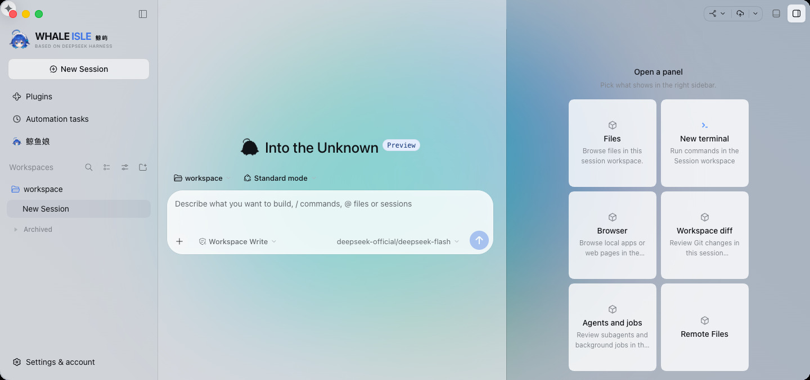
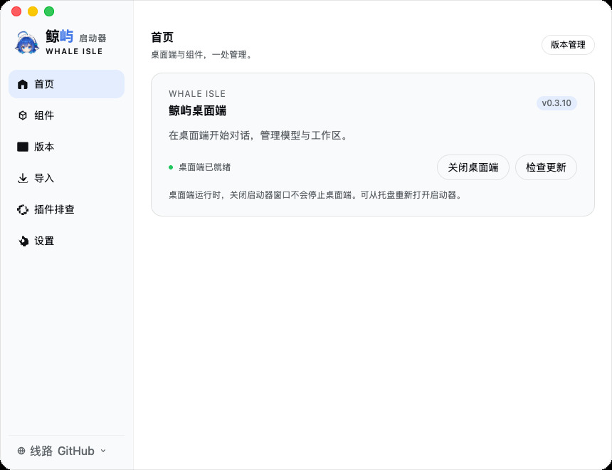
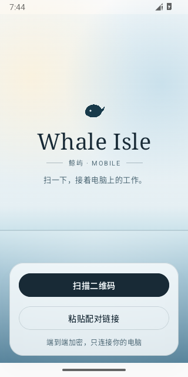

<p align="center">
  
</p>

<h1 align="center">Whale Isle</h1>

<p align="center">
  An open-source community client built on DeepSeek Harness<br />
  AI conversations, file previews, terminal and Git in one window.
</p>

<p align="center">
  <a href="README.md">中文</a> · English ·
  <a href="https://github.com/ChisaAlter/WhaleIsle/releases/tag/v0.3.13">Release notes</a> ·
  <a href="https://github.com/ChisaAlter/WhaleIsle/issues">Report an issue</a>
</p>

<p align="center">
  <a href="https://github.com/ChisaAlter/WhaleIsle/releases/latest"></a>
  <a href="LICENSE"></a>
  
  
  
</p>

<p align="center">
  
</p>

Independently maintained by the community, not an official DeepSeek product. Built on [DeepSeek Harness](https://github.com/deepseek-ai/deepseek-harness).

## Download v0.3.13

| Platform | GitHub | CNB mirror |
| --- | --- | --- |
| Windows 10+ · x64 | [Installer](https://github.com/ChisaAlter/WhaleIsle/releases/download/v0.3.13/Whale-Isle-Setup-0.3.13.exe) | [CNB](https://cnb.cool/ayasealter/WhaleIsle/-/releases/download/v0.3.13/Whale-Isle-Setup-0.3.13.exe) |
| macOS 14+ · Apple Silicon | [ARM64 DMG](https://github.com/ChisaAlter/WhaleIsle/releases/download/v0.3.13/Whale-Isle-0.3.13-mac-arm64.dmg) | [CNB](https://cnb.cool/ayasealter/WhaleIsle/-/releases/download/v0.3.13/Whale-Isle-0.3.13-mac-arm64.dmg) |
| Android 8.0+ | [APK](https://github.com/ChisaAlter/WhaleIsle/releases/download/android-v0.3.11/Whale-Isle-0.3.11-android.apk) | [CNB](https://cnb.cool/ayasealter/WhaleIsle/-/releases/download/android-v0.3.11/Whale-Isle-0.3.11-android.apk) |

The Windows package is unsigned. The Mac package is unsigned, not notarized, and excludes the Windows-only Office runtime; right-click and choose Open the first time. The Android APK is release-signed and released separately. Each release provides SHA512 checksums.

1. Install the desktop app and configure an API service in Settings → Models.
2. Choose a workspace or start a conversation without one.
3. On Android, scan the QR code in the desktop app's Remote dialog to connect.

Your model provider charges for usage; this project supplies no credits. See the [Android release notes](https://github.com/ChisaAlter/WhaleIsle/releases/tag/android-v0.3.11) for validation scope.

## Features

- **Conversations and collaboration**: Tool calls, approvals and Agent Teams; enable Project in Settings.
- **Files and development**: File editing, web and diff previews, terminal and Git.
- **Live panels**: Bundled floating panels with command, HTTP or AI refreshes, plus interactive Whale UI.
- **Models and extensions**: API services, MCP, skills and the plugin marketplace; optional WhaleBridge on Windows.
- **Appearance and usage**: Codex / Claude skins, wallpapers, a Live2D whale companion, token and cost statistics.

<table>
  <tr><th>0.3.10 launcher · macOS</th><th>Android connection screen</th></tr>
  <tr>
    <td align="center"></td>
    <td align="center"></td>
  </tr>
</table>

WhaleBridge and the ChatGPT plugin are installed and updated separately from the desktop app. See the [component documentation](docs/features/launcher-components.md).

## Run from source

Requires Git and Node.js 22.19+ (22.x) or 24+. The CI version is in [.nvmrc](.nvmrc).

```shell
git clone https://github.com/ChisaAlter/WhaleIsle.git
cd WhaleIsle
npm ci
npm run setup:harness
npm start
```

The first setup builds Harness. Source and installed builds share a single-instance lock; quit the installed app, including its tray process, first.

## Data and documentation

Desktop data lives in `%APPDATA%\Deepseek-Harness-Desktop` on Windows or `~/Library/Application Support/Deepseek-Harness-Desktop` on macOS. In-place upgrades preserve it. Use Import in the launcher for official CLI data, or Plugin troubleshooting for plugin startup issues.

[Product handbook](docs/handbook/README.md) · [Development](docs/maintenance/README.md) · [Contributing](CONTRIBUTING.en.md) · [Report an issue](https://github.com/ChisaAlter/WhaleIsle/issues/new/choose)

<p align="center">
  
</p>

Thanks to [DeepSeek Harness](https://github.com/deepseek-ai/deepseek-harness), [yetone / Magpie](https://github.com/yetone/magpie) and the [Linux.do](https://linux.do) community. · [MIT](LICENSE)
