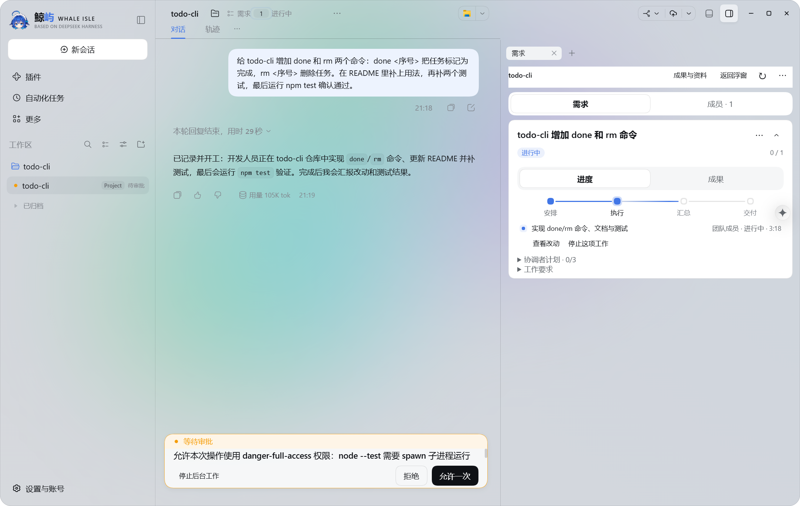
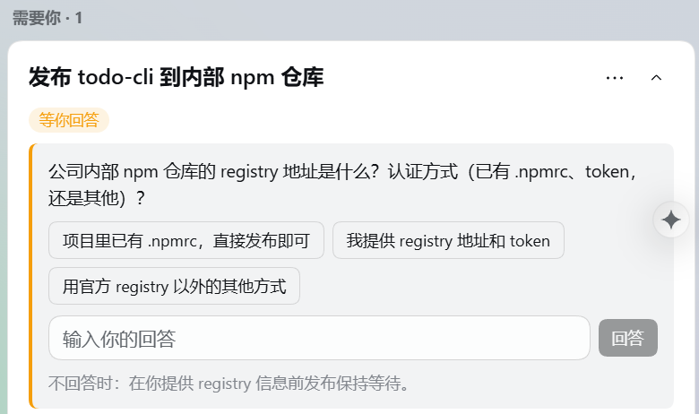
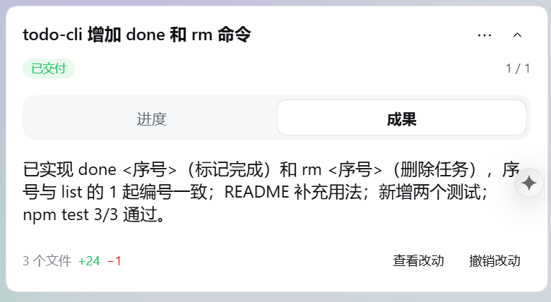
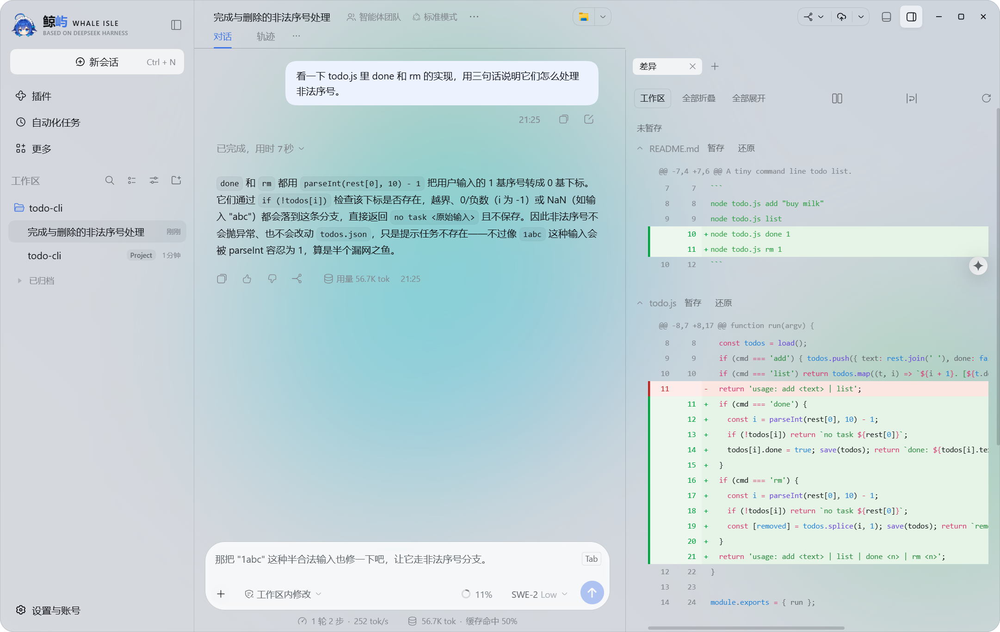
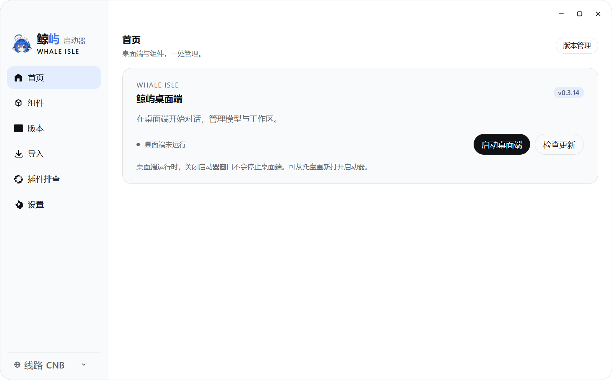
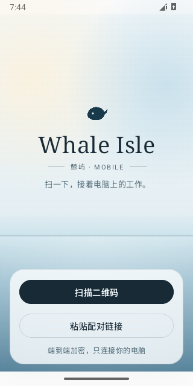

<p align="center">
  
</p>

<h1 align="center">Whale Isle</h1>

<p align="center">
  An open-source community desktop client built on DeepSeek Harness<br />
  Conversations, files, terminal, Git and AI team work in one window.
</p>

<p align="center">
  <a href="README.md">中文</a> · English ·
  <a href="https://github.com/ChisaAlter/WhaleIsle/releases/latest">Release notes</a> ·
  <a href="https://github.com/ChisaAlter/WhaleIsle/issues">Report an issue</a>
</p>

<p align="center">
  <a href="https://github.com/ChisaAlter/WhaleIsle/releases/latest"></a>
  <a href="LICENSE"></a>
  
  
  
</p>

<p align="center">
  
</p>

Independently maintained by the community, not an official DeepSeek product.

## What it is

Whale Isle turns [DeepSeek Harness](https://github.com/deepseek-ai/deepseek-harness) into a ready-to-use desktop app: the service starts on your machine, your data stays on your machine, and the interface, updates and model setup all live in the app.

| You want to | Whale Isle gives you |
| --- | --- |
| Change code together with a model | Read and write files and run commands right in the conversation; anything that needs more permission asks you first |
| Hand a task to an AI team | **Project**: state the goal, members work in parallel, and you are interrupted only when you are needed |
| See results without leaving the window | Files, diffs, web previews, a terminal and Git next to the conversation |
| Keep going away from your PC | Connect the Android app to the desktop by scanning a QR code |

## Download

| Platform | GitHub | CNB mirror |
| --- | --- | --- |
| Windows 10+ · x64 · v0.3.14 | [Installer](https://github.com/ChisaAlter/WhaleIsle/releases/download/v0.3.14/Whale-Isle-Setup-0.3.14.exe) | [CNB](https://cnb.cool/ayasealter/WhaleIsle/-/releases/download/v0.3.14/Whale-Isle-Setup-0.3.14.exe) |
| macOS 14+ · Apple Silicon · v0.3.13 | [ARM64 DMG](https://github.com/ChisaAlter/WhaleIsle/releases/download/v0.3.13/Whale-Isle-0.3.13-mac-arm64.dmg) | [CNB](https://cnb.cool/ayasealter/WhaleIsle/-/releases/download/v0.3.13/Whale-Isle-0.3.13-mac-arm64.dmg) |
| Android 8.0+ · v0.3.11 | [APK](https://github.com/ChisaAlter/WhaleIsle/releases/download/android-v0.3.11/Whale-Isle-0.3.11-android.apk) | [CNB](https://cnb.cool/ayasealter/WhaleIsle/-/releases/download/android-v0.3.11/Whale-Isle-0.3.11-android.apk) |

v0.3.14 has no Mac installer yet, so the table lists the latest Mac version; Android is released separately. The desktop installers are unsigned; on a Mac, right-click and choose Open the first time. Each release provides SHA512 checksums.

## Getting started

1. Install and start the desktop app (the launcher handles versions, updates, import and components).
2. Open Settings → Models and configure an API service; your model provider charges for usage.
3. Choose a workspace, or just start a new conversation.
4. To let a team do the work: turn on Project in Settings → Built-in features, then click "Project" on the new-session screen.
5. To use your phone: scan the QR code in the desktop app's Remote dialog with the Android app.

## Highlights

### Project: state the goal, let a team do it

Project turns a local directory into a long-running project. You keep adding requirements in the main conversation, the coordinator hands them to team members (subagents) one by one, and the Requests panel on the right shows stages, member progress and results.

- **Interrupts you only when needed**: when information or a decision is missing, the coordinator asks one concrete question with a few answers you can click, pinned in the panel, and the header shows "N waiting for you".
- **Asks before taking more permission**: when a member needs to run a command outside the sandbox, an approval appears above the input box; approve once, it runs once.
- **Can research the web**: members can search and read web pages (read-only, no commands), the sources they consulted are recorded with the result, and you can set an allowlist of research sites in the materials.
- **Results you can inspect**: after delivery you can review the changes, and undo them.

<table>
  <tr>
    <td align="center"></td>
    <td align="center"></td>
  </tr>
  <tr>
    <td align="center">Needs you: one concrete question, click or type</td>
    <td align="center">Delivered: summary and changes, undoable any time</td>
  </tr>
</table>

Project is off by default; turning it off only hides the entry points and keeps the data of existing Projects.

### Development workbench

<p align="center">
  
</p>

- **Files and previews**: browse and edit workspace files; web pages and diffs preview in the built-in panel.
- **Terminal and Git**: a terminal drawer at the bottom, and branch switching and Git status in the title bar.
- **SSH remote workspaces**: use a directory on a remote machine as your workspace.
- **Live panels**: floating panels refreshed by commands, HTTP or AI.

Common shortcuts: `Ctrl+N` new session · `Ctrl+\` right sidebar · `` Ctrl+` `` terminal · `Ctrl+,` settings.

### More

| Feature | What it does |
| --- | --- |
| **Whale UI** | Generate interactive pages in the conversation: charts, forms, Mermaid, 3D, maps, quizzes and more |
| **Phone remote** | Connect the Android app by QR code; off by default, and it listens only once enabled |
| **Extensions** | MCP, skills and the plugin marketplace; on Windows, install [WhaleBridge](docs/features/launcher-components.md) to manage model providers, subscription logins, routing and usage |
| **Updates** | The update center downloads and verifies in the background, picks the cheaper of an incremental or full download, and resumes after a dropped connection or a restart |
| **Appearance and usage** | Codex / Claude skins, a wallpaper gallery, a Live2D whale companion, token and cost statistics |

<table>
  <tr><th>Launcher</th><th>Android connection screen</th></tr>
  <tr>
    <td align="center"></td>
    <td align="center"></td>
  </tr>
</table>

## FAQ

- **Does it cost money?** The app is free and open source (MIT); the model provider you configure charges for usage.
- **Where is my data?** `%APPDATA%\Deepseek-Harness-Desktop` on Windows and `~/Library/Application Support/Deepseek-Harness-Desktop` on macOS, kept across in-place upgrades. The desktop app does not read the official `~/.dsh`; the launcher's Import page can bring in its skills, MCP servers and settings.
- **How is it different from the official `dsh web`?** The interface and core capabilities are the same; the desktop app adds the launcher, terminal, Git, workspace files, SSH remote workspaces, phone remote, the plugin marketplace, wallpapers and usage statistics.
- **How do I upgrade?** The app checks and downloads new versions in the background; once ready, click "Install and restart" in Settings → About, the tray or the launcher.

## Run from source

Requires Git and Node.js 22.19+ or 24+ (the CI version is in [.nvmrc](.nvmrc)). Quit the installed app, including its tray process, first: both share a single-instance lock.

```shell
git clone https://github.com/ChisaAlter/WhaleIsle.git
cd WhaleIsle
npm ci
npm run setup:harness
npm start
```

| Directory | Contents |
| --- | --- |
| `src/main`, `src/renderer` | The Electron main process; the launcher and boot pages |
| `vendor/deepseek-harness` | Upstream DeepSeek Harness (pinned and synced) |
| `vendor/dsh-project` | The Project plugin |
| `mobile/` | The Android app and the phone web page |
| `scripts/` | Build, packaging and release scripts |
| `docs/` | Product handbook, feature cards and maintenance docs |

## Documentation and community

[Product handbook](docs/handbook/README.md) · [Development](docs/maintenance/README.md) · [Contributing](CONTRIBUTING.en.md) · [Report an issue](https://github.com/ChisaAlter/WhaleIsle/issues/new/choose)

<p align="center">
  
</p>

Thanks to [DeepSeek Harness](https://github.com/deepseek-ai/deepseek-harness), [yetone / Magpie](https://github.com/yetone/magpie) and the [Linux.do](https://linux.do) community. · [MIT](LICENSE)
