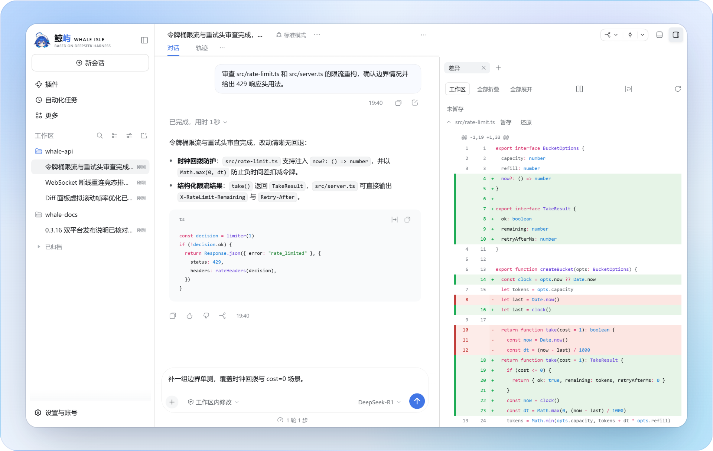
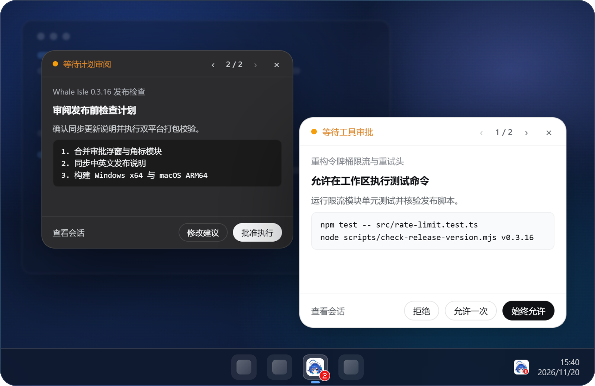
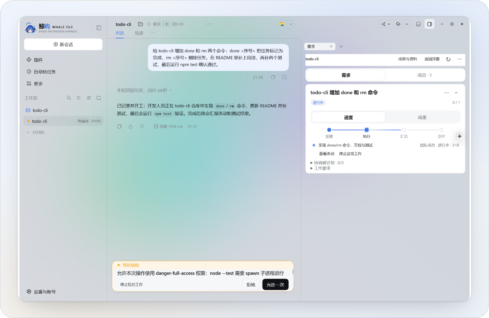
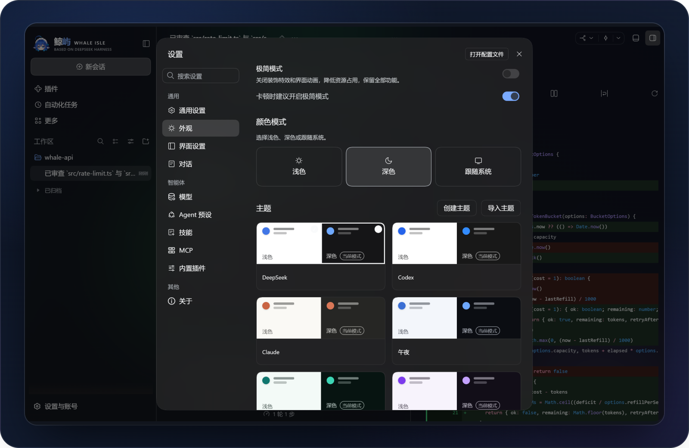
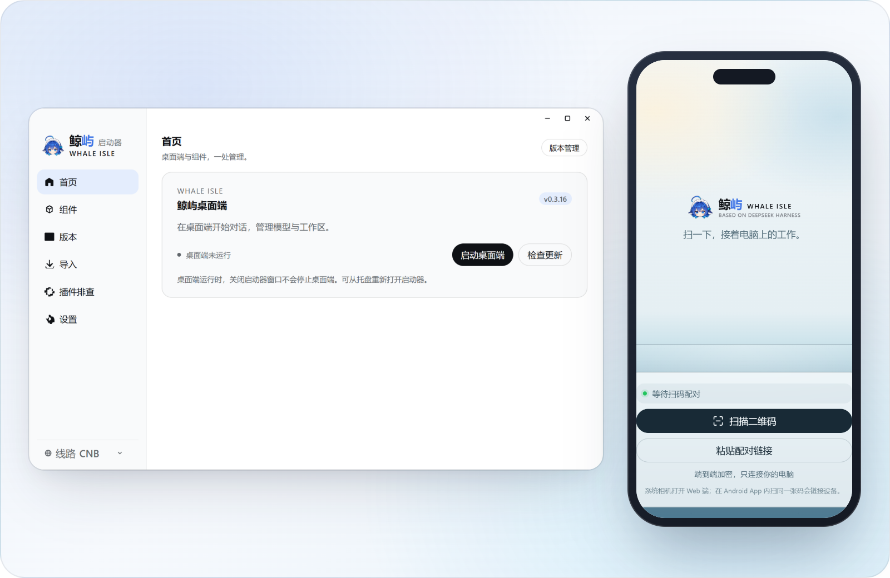

<div align="center">


# WhaleIsle

<p>
  An open-source community desktop client built on <a href="https://github.com/deepseek-ai/deepseek-harness">DeepSeek Harness</a><br />
  Conversations, code workbench, AI teams, and mobile remote in one window.
</p>

<p>
  <a href="README.md">中文</a> ·
  <strong>English</strong> ·
  <a href="#download">Download</a> ·
  <a href="#screenshots">Screenshots</a> ·
  <a href="#run-from-source">Run from source</a> ·
  <a href="https://github.com/ChisaAlter/WhaleIsle/releases/latest">Release notes</a> ·
  <a href="https://github.com/ChisaAlter/WhaleIsle/issues">Issues</a>
</p>

<p>
  <a href="https://github.com/ChisaAlter/WhaleIsle/releases/latest"></a>
  <a href="LICENSE"></a>
  
  
  
</p>

<br />

<picture>
  <source media="(prefers-color-scheme: dark)" srcset="docs/images/v0.3.16/hero-dark.png" />
  <source media="(prefers-color-scheme: light)" srcset="docs/images/v0.3.16/hero-light.png" />
  
</picture>

<p>
  <sub>Independently maintained by the community, not an official DeepSeek product. The service runs locally and your data stays on your machine.</sub>
</p>

</div>

---

## Features

<table>
  <tr>
    <td width="50%" valign="top">
      <strong>All-in-one code workbench</strong><br />
      Browse and edit workspace files, review Git diffs, switch branches, and commit right next to the conversation. Includes a terminal drawer, floating web and artifact previews, and SSH remote workspaces.
    </td>
    <td width="50%" valign="top">
      <strong>Project and Agent Teams</strong><br />
      Ships with ACP 0.4.9 and Agent Teams: choose an agent first, then preview its model and reasoning effort. Turn on Project to delegate goals to parallel subagents with inspectable, undoable deliverables.
    </td>
  </tr>
  <tr>
    <td width="50%" valign="top">
      <strong>Minimized approval popup and badges</strong><br />
      When the main window is minimized or hidden to the tray, pending tool, permission, and plan approvals open an unfocused floating card in the bottom-right corner and update the taskbar, tray, or macOS Dock badge.
    </td>
    <td width="50%" valign="top">
      <strong>Whale UI and Whale assistant</strong><br />
      Render interactive charts, forms, Mermaid diagrams, 3D scenes, and maps directly inside a reply. Enable the optional Whale assistant for Big Fish focus mode, automatic context compaction with <code>/compact</code>, and a Live2D desktop companion.
    </td>
  </tr>
  <tr>
    <td width="50%" valign="top">
      <strong>Native look and acrylic material</strong><br />
      Switch between DeepSeek, Codex, Claude, Midnight, Celadon, Paper, and more paired light/dark themes, plus a wallpaper gallery and ambient gradients. Windows 11 22H2+ supports native window acrylic with 20px rounded corners.
    </td>
    <td width="50%" valign="top">
      <strong>Launcher and mobile remote</strong><br />
      A dedicated launcher manages desktop versions, resumable delta updates, official config imports, and <a href="docs/features/launcher-components.md">Magpie</a>. Scan a QR code from the Android app or mobile web client for an end-to-end encrypted session away from your desk.
    </td>
  </tr>
</table>

---

## Screenshots

<table>
  <tr>
    <td width="50%" align="center" valign="top">
      <br />
      <strong>Minimized approval popup and badges</strong><br />
      <sub>Approve, deny, or review plans without stealing focus, with queue paging and one-click session jump.</sub>
    </td>
    <td width="50%" align="center" valign="top">
      <br />
      <strong>Project team workflow</strong><br />
      <sub>Track stages and member progress in the right panel; the coordinator interrupts only for decisions or permissions.</sub>
    </td>
  </tr>
  <tr>
    <td width="50%" align="center" valign="top">
      <br />
      <strong>Themes and native window materials</strong><br />
      <sub>Paired light and dark themes, wallpaper gallery, glass opacity controls, and Windows 11 acrylic.</sub>
    </td>
    <td width="50%" align="center" valign="top">
      <br />
      <strong>Launcher and mobile remote</strong><br />
      <sub>Manage versions, CNB/GitHub routes, and components from the launcher; pair your phone with one scan.</sub>
    </td>
  </tr>
</table>

---

## Download

| Platform | Version | GitHub Releases | CNB mirror |
| --- | --- | --- | --- |
| **Windows 10 / 11** (x64) | `v0.3.16` | [Whale-Isle-Setup-0.3.16.exe](https://github.com/ChisaAlter/WhaleIsle/releases/download/v0.3.16/Whale-Isle-Setup-0.3.16.exe) | [CNB](https://cnb.cool/ayasealter/WhaleIsle/-/releases/download/v0.3.16/Whale-Isle-Setup-0.3.16.exe) |
| **macOS 14+** (Apple Silicon) | `v0.3.16` | [Whale-Isle-0.3.16-mac-arm64.dmg](https://github.com/ChisaAlter/WhaleIsle/releases/download/v0.3.16/Whale-Isle-0.3.16-mac-arm64.dmg) | [CNB](https://cnb.cool/ayasealter/WhaleIsle/-/releases/download/v0.3.16/Whale-Isle-0.3.16-mac-arm64.dmg) |
| **Android 8.0+** (separate release) | `v0.3.11` | [Whale-Isle-0.3.11-android.apk](https://github.com/ChisaAlter/WhaleIsle/releases/download/android-v0.3.11/Whale-Isle-0.3.11-android.apk) | [CNB](https://cnb.cool/ayasealter/WhaleIsle/-/releases/download/android-v0.3.11/Whale-Isle-0.3.11-android.apk) |

> [!NOTE]
> Desktop installers are currently unsigned. On macOS, right-click the app and select Open on first launch. Every release ships with a `SHA512SUMS.txt` checksum manifest. Windows 11 window acrylic requires Windows 11 22H2 or later.

### Quick start

1. Install and launch WhaleIsle (use the launcher to manage versions, download routes, imports, and Magpie).
2. Open **Settings → Models** to configure your API provider. Model usage is billed by your chosen provider.
3. Pick a local folder or mount an SSH remote workspace, then start a new conversation.
4. Enable optional capabilities as needed: **Settings → Built-in plugins** for Project, **Settings → Whale** for the assistant, and **Settings → Remote** for QR pairing.

---

## Shortcuts and FAQ

<details>
<summary><strong>Common shortcuts</strong></summary>

| Shortcut | Action |
| --- | --- |
| `Ctrl+N` / `Cmd+N` | New session |
| `Ctrl+\` / `Cmd+\` | Toggle right workbench sidebar |
| `` Ctrl+` `` / `` Cmd+` `` | Toggle bottom terminal drawer |
| `Ctrl+,` / `Cmd+,` | Open settings |
| `Esc` | Close dialog or snooze the approval popup without rejecting |

</details>

<details>
<summary><strong>Frequently asked questions</strong></summary>

- **Does WhaleIsle cost money?**
  The app is free and open source under the MIT license. Your model provider charges for API usage.
- **Where is my data stored, and do upgrades keep it?**
  Data lives in `%APPDATA%\Deepseek-Harness-Desktop` on Windows and `~/Library/Application Support/Deepseek-Harness-Desktop` on macOS, and stays intact across in-place upgrades. WhaleIsle does not read the official `~/.dsh` directory; use the launcher's Import tab to bring over skills, MCP servers, and settings read-only.
- **How is it different from the official `dsh web`?**
  Core conversation and runtime behavior match the pinned upstream release. The desktop client adds the launcher, resumable delta updates, workspace files and diffs, titlebar Git controls, an integrated terminal, SSH remote workspaces, minimized approval popups, mobile remote, a built-in marketplace, themes, and usage statistics.
- **How do I update?**
  The update center checks and downloads releases in the background, picks incremental or full packages automatically, and resumes interrupted transfers. Click Install and restart from **Settings → About**, the tray menu, or the launcher. You can also configure a dedicated HTTP proxy for update downloads.

</details>

---

## Run from source

Requires Git and Node.js 24.9+ (CI pins the exact version in [.nvmrc](.nvmrc)). Quit the installed app and its tray process before running from source because both share a single-instance lock.

```shell
git clone https://github.com/ChisaAlter/WhaleIsle.git
cd WhaleIsle
npm ci
npm run setup:harness
npm start
```

<details>
<summary><strong>Repository layout</strong></summary>

| Path | Responsibility |
| --- | --- |
| `src/main`, `src/preload`, `src/renderer` | Electron main process, sandboxed preloads, launcher, boot page, and approval popup |
| `src/whale-ui` | Whale UI interactive page runtime and component library |
| `vendor/deepseek-harness` | Upstream DeepSeek Harness (pinned and synced) |
| `vendor/dsh-project`, `vendor/dsh-whale`, etc. | Bundled first-party plugins (Project, Whale assistant, SSH remote, live panels, usage, IM) |
| `dsh-acp` | Bundled ACP 0.4.9 and Agent Teams integration |
| `mobile/` | Native Android client and mobile web SPA |
| `scripts/` | Build, verification, packaging, and release scripts |
| `docs/` | Product handbook, feature cards, design language, and maintenance docs |

</details>

---

## Documentation and community

- [Product handbook](docs/handbook/README.md) · [Feature index](docs/features/README.md) · [Design language](docs/design-language.md)
- [Development guide](docs/maintenance/README.md) · [Release process](docs/handbook/modules/release-process.md) · [Contributing](CONTRIBUTING.en.md)

<div align="center">
  <br />
  <sub>Scan to join the WhaleIsle WeChat community</sub>
  <br /><br />
  <sub>
    Thanks to <a href="https://github.com/deepseek-ai/deepseek-harness">DeepSeek Harness</a> ·
    <a href="https://github.com/yetone/magpie">yetone / Magpie</a> ·
    <a href="https://linux.do">Linux.do</a> ·
    <a href="LICENSE">MIT License</a>
  </sub>
</div>
