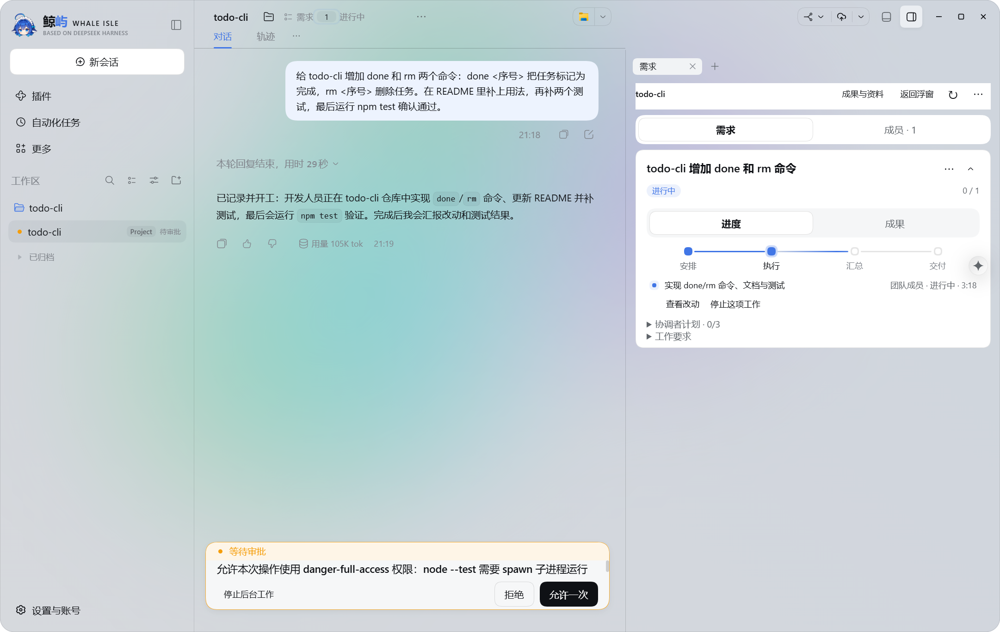
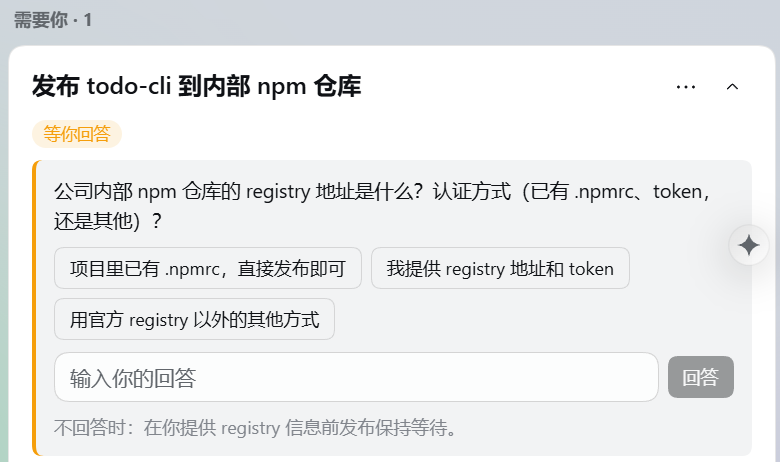
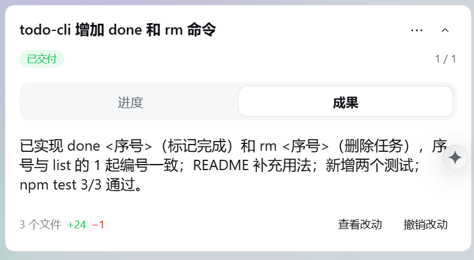
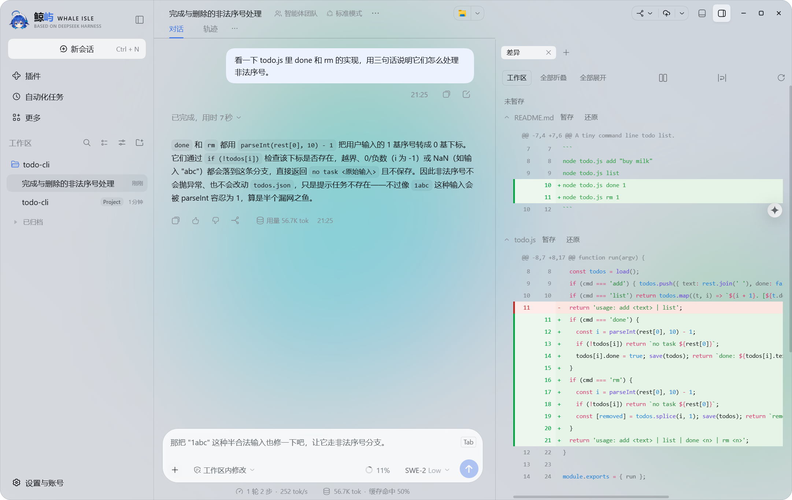
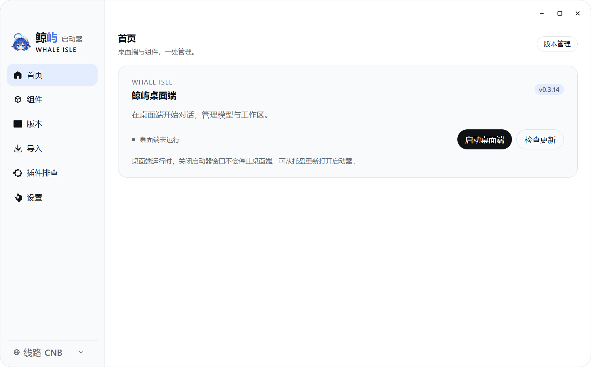
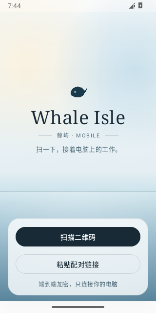

<p align="center">
  
</p>

<h1 align="center">鲸屿 Whale Isle</h1>

<p align="center">
  基于 DeepSeek Harness 的开源社区桌面客户端<br />
  对话、文件、终端、Git 与 AI 团队协作，一个窗口完成。
</p>

<p align="center">
  中文 · <a href="README.en.md">English</a> ·
  <a href="https://github.com/ChisaAlter/WhaleIsle/releases/latest">更新说明</a> ·
  <a href="https://github.com/ChisaAlter/WhaleIsle/issues">反馈</a>
</p>

<p align="center">
  <a href="https://github.com/ChisaAlter/WhaleIsle/releases/latest"></a>
  <a href="LICENSE"></a>
  
  
  
</p>

<p align="center">
  
</p>

社区独立维护，非 DeepSeek 官方产品。

## 它是什么

鲸屿把 [DeepSeek Harness](https://github.com/deepseek-ai/deepseek-harness) 做成开箱即用的桌面应用：服务在本机启动，数据在本机保存，界面、更新和模型配置都在应用里完成。

| 你想做的事 | 鲸屿提供 |
| --- | --- |
| 和模型一起改代码 | 对话里直接读写文件、运行命令；需要更高权限的操作先请你批准 |
| 把一件事交给 AI 团队 | **Project**：说目标，成员分头执行，只在需要你时才打扰你 |
| 不离开窗口看结果 | 文件、Diff、网页预览、终端、Git 都在对话旁边 |
| 离开电脑也能接着用 | Android 客户端扫码连接桌面端 |

## 下载

| 平台 | GitHub | 国内镜像 |
| --- | --- | --- |
| Windows 10+ · x64 · v0.3.14 | [安装包](https://github.com/ChisaAlter/WhaleIsle/releases/download/v0.3.14/Whale-Isle-Setup-0.3.14.exe) | [CNB](https://cnb.cool/ayasealter/WhaleIsle/-/releases/download/v0.3.14/Whale-Isle-Setup-0.3.14.exe) |
| macOS 14+ · Apple Silicon · v0.3.13 | [ARM64 DMG](https://github.com/ChisaAlter/WhaleIsle/releases/download/v0.3.13/Whale-Isle-0.3.13-mac-arm64.dmg) | [CNB](https://cnb.cool/ayasealter/WhaleIsle/-/releases/download/v0.3.13/Whale-Isle-0.3.13-mac-arm64.dmg) |
| Android 8.0+ · v0.3.11 | [APK](https://github.com/ChisaAlter/WhaleIsle/releases/download/android-v0.3.11/Whale-Isle-0.3.11-android.apk) | [CNB](https://cnb.cool/ayasealter/WhaleIsle/-/releases/download/android-v0.3.11/Whale-Isle-0.3.11-android.apk) |

v0.3.14 暂未提供 Mac 安装包，上表是最新的 Mac 版本；Android 独立发布。桌面安装包未签名，Mac 首次打开需右键「打开」。各发布页附 SHA512 校验清单。

## 快速开始

1. 安装并启动桌面端（启动器负责版本、更新、导入和组件）。
2. 打开「设置 → 模型」配置 API 服务，费用由模型服务商收取。
3. 选择工作目录，或直接新建会话开始对话。
4. 想让团队替你做事：「设置 → 内置功能」开启 Project，再在新会话首屏点「Project」。
5. 想用手机：桌面端「远程」里扫码，用 Android 客户端连接。

## 亮点

### Project：说目标，团队来做

Project 把一个本地目录变成长期项目。你在主对话里连续提需求，协调者把它们交给团队成员（子智能体）逐个完成；右侧「需求」面板显示阶段、成员进度和交付结果。

- **只在需要你时打扰你**：缺信息或需要你拍板时，协调者只问一个具体问题，附几个可点选的答案，置顶在面板里，标题栏同步提示「N 项等你」。
- **要权限先问**：成员要运行超出沙箱的命令时，输入框上方会弹出审批，批准一次，执行一次。
- **能上网查资料**：成员可以搜索、阅读网页（只读，不能执行命令），查阅的来源记录在成果里；可在材料中设置研究站点白名单。
- **结果看得见**：交付后可以查看改动，也可以撤销改动。

<table>
  <tr>
    <td align="center"></td>
    <td align="center"></td>
  </tr>
  <tr>
    <td align="center">需要你：一个具体问题，点选或输入即可</td>
    <td align="center">已交付：摘要、改动，随时可撤销</td>
  </tr>
</table>

Project 默认关闭，关闭只是隐藏入口，已有 Project 的数据会保留。

### 开发工作台

<p align="center">
  
</p>

- **文件与预览**：浏览、编辑工作区文件，网页与 Diff 在内嵌面板里预览。
- **终端与 Git**：底部终端抽屉，标题栏里切换分支、查看 Git 状态。
- **SSH 远程工作区**：把远程机器上的目录当作工作区使用。
- **实时面板**：悬浮面板，可用命令、HTTP 或 AI 持续刷新。

常用快捷键：`Ctrl+N` 新会话 · `Ctrl+\` 右侧栏 · `` Ctrl+` `` 终端 · `Ctrl+,` 设置。

### 更多

| 能力 | 说明 |
| --- | --- |
| **Whale UI** | 对话里生成可交互页面：图表、表单、Mermaid、3D、地图、测验等 |
| **手机远程** | Android 客户端扫码连接，默认关闭，开启后才监听 |
| **扩展** | MCP、技能、插件市场；Windows 可安装[鲸桥](docs/features/launcher-components.md)，管理模型供应商、订阅登录、路由与用量 |
| **更新** | 更新中心后台下载并校验，自动选更省的增量或完整下载，断网或重启后可续传 |
| **外观与用量** | Codex / Claude 皮肤、壁纸图库、Live2D 鲸鱼娘、Token 与费用统计 |

<table>
  <tr><th>启动器</th><th>Android 连接页</th></tr>
  <tr>
    <td align="center"></td>
    <td align="center"></td>
  </tr>
</table>

## 常见问题

- **要花钱吗？** 软件免费开源（MIT）；模型费用由你配置的服务商收取。
- **数据保存在哪？** Windows 在 `%APPDATA%\Deepseek-Harness-Desktop`，macOS 在 `~/Library/Application Support/Deepseek-Harness-Desktop`，覆盖安装会保留。桌面端不读取官方 `~/.dsh`，可在启动器「导入」页导入其中的技能、MCP 与设置。
- **和官方 `dsh web` 有什么区别？** 界面和核心能力一致，桌面端额外提供启动器、终端、Git、工作区文件、SSH 远程工作区、手机远程、插件市场、壁纸和用量统计。
- **怎么升级？** 应用会在后台检查并下载新版，准备好后在「设置 → 关于」、托盘或启动器里点「安装并重启」。

## 从源码运行

需要 Git 和 Node.js 22.19+ 或 24+（CI 版本见 [.nvmrc](.nvmrc)）。运行前先退出安装版及托盘，两者共用单实例锁。

```shell
git clone https://github.com/ChisaAlter/WhaleIsle.git
cd WhaleIsle
npm ci
npm run setup:harness
npm start
```

| 目录 | 内容 |
| --- | --- |
| `src/main`、`src/renderer` | Electron 主进程；启动器与启动页 |
| `vendor/deepseek-harness` | 上游 DeepSeek Harness（钉版同步） |
| `vendor/dsh-project` | Project 插件 |
| `mobile/` | Android 客户端与手机网页 |
| `scripts/` | 构建、打包与发布脚本 |
| `docs/` | 产品手册、功能卡与维护文档 |

## 文档与社区

[产品手册](docs/handbook/README.md) · [开发文档](docs/maintenance/README.md) · [贡献指南](CONTRIBUTING.md) · [反馈问题](https://github.com/ChisaAlter/WhaleIsle/issues/new/choose)

<p align="center">
  
</p>

感谢 [DeepSeek Harness](https://github.com/deepseek-ai/deepseek-harness)、[yetone / Magpie](https://github.com/yetone/magpie) 与 [Linux.do](https://linux.do) 社区。· [MIT](LICENSE)
