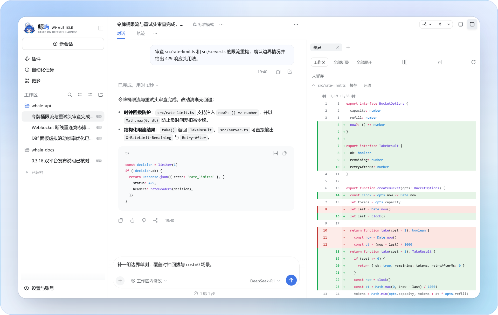
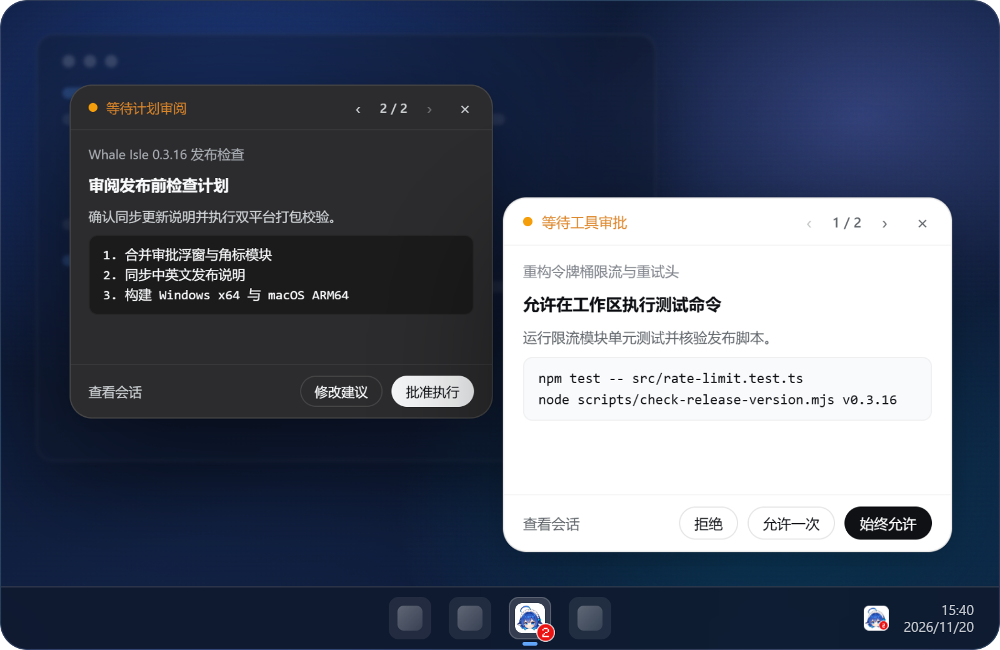
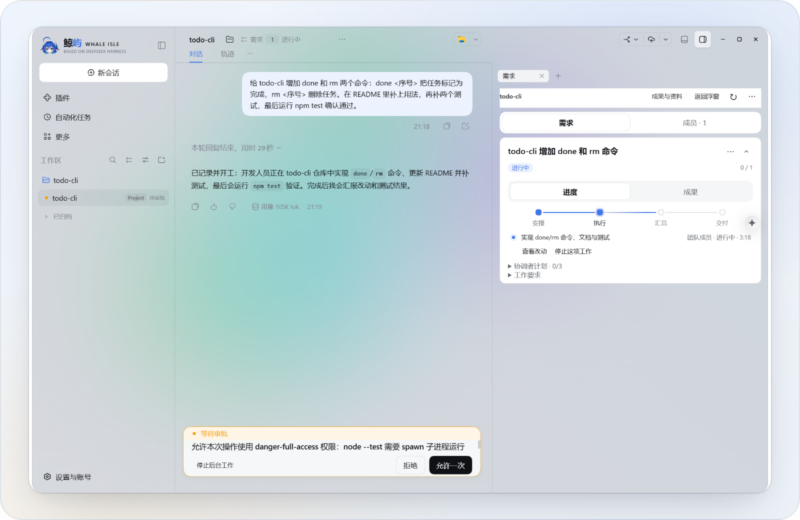
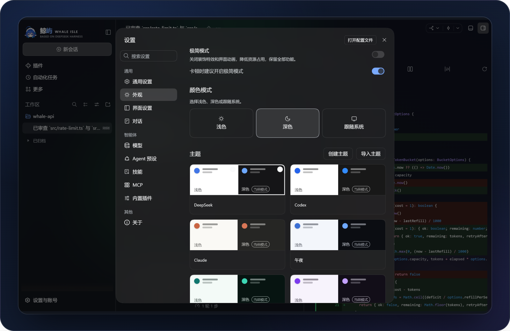
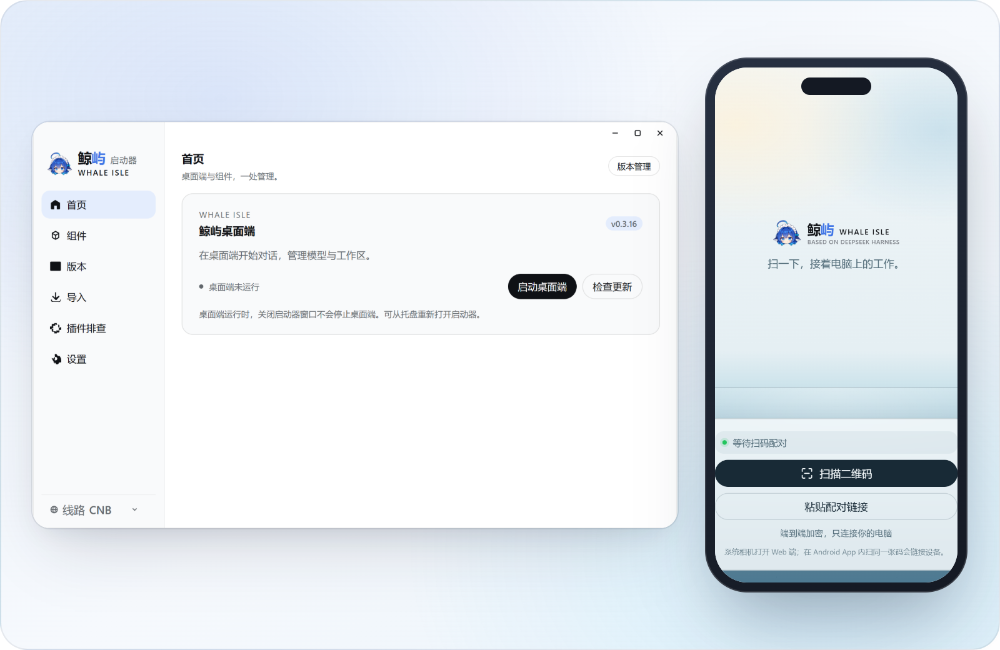

<div align="center">


# WhaleIsle

<p>
  <strong>鲸屿</strong> · 基于 <a href="https://github.com/deepseek-ai/deepseek-harness">DeepSeek Harness</a> 的开源社区桌面客户端<br />
  对话、代码工作台、AI 团队协作与多端远程，收纳于同一窗口。
</p>

<p>
  <strong>中文</strong> ·
  <a href="README.en.md">English</a> ·
  <a href="#下载安装">下载安装</a> ·
  <a href="#界面预览">界面预览</a> ·
  <a href="#从源码运行">从源码运行</a> ·
  <a href="https://github.com/ChisaAlter/WhaleIsle/releases/latest">更新说明</a> ·
  <a href="https://github.com/ChisaAlter/WhaleIsle/issues">问题反馈</a>
</p>

<p>
  <a href="https://github.com/ChisaAlter/WhaleIsle/releases/latest"></a>
  <a href="LICENSE"></a>
  
  
  
</p>

<br />

<picture>
  <source media="(prefers-color-scheme: dark)" srcset="docs/images/v0.3.16/hero-dark.png" />
  <source media="(prefers-color-scheme: light)" srcset="docs/images/v0.3.16/hero-light.png" />
  
</picture>

<p>
  <sub>社区独立维护，非 DeepSeek 官方产品。服务在本机启动，会话与配置均保存在本机。</sub>
</p>

</div>

---

## 核心特性

<table>
  <tr>
    <td width="50%" valign="top">
      <strong>一体化开发工作台</strong><br />
      在对话旁直接浏览编辑工作区文件、审阅 Git 差异、切换分支并一键提交。底部内嵌终端抽屉，网页与产物支持聊天区悬浮预览，也支持把 SSH 远程目录挂载为工作区。
    </td>
    <td width="50%" valign="top">
      <strong>Project 与 Agent Teams</strong><br />
      内置 ACP 0.4.9 与 Agent Teams，先选 Agent，再预览并切换模型与推理档位。开启 Project 后，在主对话提出目标即可交由子智能体并行推进，交付改动可查看、可撤销。
    </td>
  </tr>
  <tr>
    <td width="50%" valign="top">
      <strong>最小化审批浮窗与角标</strong><br />
      主窗口最小化或隐藏至托盘时，工具审批、权限审批与计划审阅会在右下角以不抢焦点的独立浮窗弹出，并同步在任务栏、托盘或 macOS Dock 图标显示待处理数字角标。
    </td>
    <td width="50%" valign="top">
      <strong>Whale UI 与鲸鱼娘助理</strong><br />
      支持在对话中直接渲染图表、表单、Mermaid、3D 与地图等交互页面。按需启用鲸鱼娘助理，提供大肥鱼专注工作台、常驻会话自动上下文压缩与 <code>/compact</code>，以及 Live2D 桌宠。
    </td>
  </tr>
  <tr>
    <td width="50%" valign="top">
      <strong>原生外观与毛玻璃材质</strong><br />
      内置 DeepSeek、Codex、Claude、午夜、青瓷、宣纸等多套明暗皮肤，支持壁纸图库、流动渐变与透明主题。Windows 11 22H2 及以上版本可开启原生窗口毛玻璃并保留 20px 圆角。
    </td>
    <td width="50%" valign="top">
      <strong>启动器与多端远程</strong><br />
      独立启动器管理桌面版本、增量断点更新、官方配置导入与<a href="docs/features/launcher-components.md">Magpie 组件</a>。手机端通过 Android 客户端或移动端网页扫码建立端到端加密连接，离开电脑也能继续协作。
    </td>
  </tr>
</table>

---

## 界面预览

<table>
  <tr>
    <td width="50%" align="center" valign="top">
      <br />
      <strong>最小化审批浮窗与图标角标</strong><br />
      <sub>不抢焦点处理后台工具审批与计划审阅，支持队列翻页、直接决策或跳转原会话。</sub>
    </td>
    <td width="50%" align="center" valign="top">
      <br />
      <strong>Project 团队协作</strong><br />
      <sub>右侧面板实时展示阶段与成员进度；仅在缺信息或需要越权审批时打扰你。</sub>
    </td>
  </tr>
  <tr>
    <td width="50%" align="center" valign="top">
      <br />
      <strong>多主题皮肤与原生材质</strong><br />
      <sub>支持多套双色主题、壁纸图库、透明度调节与 Windows 11 原生窗口毛玻璃。</sub>
    </td>
    <td width="50%" align="center" valign="top">
      <br />
      <strong>启动器与手机远程</strong><br />
      <sub>桌面启动器统一管理版本、CNB / GitHub 线路与组件；手机扫码直连本机工作区。</sub>
    </td>
  </tr>
</table>

---

## 下载安装

| 平台 | 版本 | GitHub Releases | 国内镜像（CNB） |
| --- | --- | --- | --- |
| **Windows 10 / 11**（x64） | `v0.3.16` | [Whale-Isle-Setup-0.3.16.exe](https://github.com/ChisaAlter/WhaleIsle/releases/download/v0.3.16/Whale-Isle-Setup-0.3.16.exe) | [CNB 下载](https://cnb.cool/ayasealter/WhaleIsle/-/releases/download/v0.3.16/Whale-Isle-Setup-0.3.16.exe) |
| **macOS 14+**（Apple Silicon） | `v0.3.16` | [Whale-Isle-0.3.16-mac-arm64.dmg](https://github.com/ChisaAlter/WhaleIsle/releases/download/v0.3.16/Whale-Isle-0.3.16-mac-arm64.dmg) | [CNB 下载](https://cnb.cool/ayasealter/WhaleIsle/-/releases/download/v0.3.16/Whale-Isle-0.3.16-mac-arm64.dmg) |
| **Android 8.0+**（独立发布） | `v0.3.11` | [Whale-Isle-0.3.11-android.apk](https://github.com/ChisaAlter/WhaleIsle/releases/download/android-v0.3.11/Whale-Isle-0.3.11-android.apk) | [CNB 下载](https://cnb.cool/ayasealter/WhaleIsle/-/releases/download/android-v0.3.11/Whale-Isle-0.3.11-android.apk) |

> [!NOTE]
> 桌面安装包当前未签名；macOS 首次打开请右键应用并选择「打开」。所有正式发布页均附 `SHA512SUMS.txt` 校验清单。Windows 11 窗口毛玻璃需要 22H2 或更新版本。

### 快速开始

1. 安装并启动 WhaleIsle 桌面端（可通过启动器管理版本、更新线路、配置导入与 Magpie 组件）。
2. 打开 **设置 → 模型** 配置模型 API 服务，模型调用费用由所选服务商收取。
3. 选择本机目录（或通过 SSH 挂载远程目录），新建会话即可开始协作。
4. 按需启用扩展能力：**设置 → 内置插件** 开启 Project，**设置 → 鲸鱼娘** 开启助理，**设置 → 远程** 开启手机扫码配对。

---

## 快捷键与常见问题

<details>
<summary><strong>常用快捷键</strong></summary>

| 快捷键 | 功能 |
| --- | --- |
| `Ctrl+N` / `Cmd+N` | 新建会话 |
| `Ctrl+\` / `Cmd+\` | 展开或收起右侧工作台栏 |
| `` Ctrl+` `` / `` Cmd+` `` | 展开或收起底部终端抽屉 |
| `Ctrl+,` / `Cmd+,` | 打开设置 |
| `Esc` | 关闭弹窗或静默收起审批浮窗（不拒绝审批） |

</details>

<details>
<summary><strong>常见问题（FAQ）</strong></summary>

- **软件是否收费？**
  WhaleIsle 基于 MIT 协议免费开源；模型 API 费用由你自行配置的模型服务商收取。
- **数据保存在哪里，升级会丢失吗？**
  Windows 位于 `%APPDATA%\Deepseek-Harness-Desktop`，macOS 位于 `~/Library/Application Support/Deepseek-Harness-Desktop`，覆盖安装保留全部数据。桌面端不读取官方 `~/.dsh`，可在启动器「导入」页只读导入其中的技能、MCP 与设置。
- **和官方 `dsh web` 有什么区别？**
  核心会话与运行时与上游钉版一致；桌面端额外提供启动器、增量更新、工作区文件与 Diff、Git 标题栏操作、内嵌终端、SSH 远程工作区、最小化审批浮窗、手机远程、内置插件市场、外观主题与用量统计。
- **如何升级？**
  更新中心在后台检查并下载新版，自动选择增量或完整包并支持断点续传；准备就绪后在 **设置 → 关于**、系统托盘或启动器点击「安装并重启」。更新下载支持在设置中单独配置 HTTP 代理。

</details>

---

## 从源码运行

需要 Git 与 Node.js 24.9+（CI 固定版本见 [.nvmrc](.nvmrc)）。源码启动前请先退出已安装版本及其托盘进程，两者共用单实例锁。

```shell
git clone https://github.com/ChisaAlter/WhaleIsle.git
cd WhaleIsle
npm ci
npm run setup:harness
npm start
```

<details>
<summary><strong>仓库目录结构</strong></summary>

| 目录 | 职责 |
| --- | --- |
| `src/main`、`src/preload`、`src/renderer` | Electron 主进程、沙箱预加载、启动器、启动页与审批浮窗 |
| `src/whale-ui` | Whale UI 交互页面运行时与组件库 |
| `vendor/deepseek-harness` | 上游 DeepSeek Harness（钉版同步） |
| `vendor/dsh-project`、`vendor/dsh-whale` 等 | 内置第一方插件（Project、鲸鱼娘、SSH 远程、悬浮面板、用量与 IM） |
| `dsh-acp` | 内置 ACP 0.4.9 与 Agent Teams 适配包 |
| `mobile/` | 原生 Android 客户端与移动端远程网页 |
| `scripts/` | 构建、校验、打包与发布脚本 |
| `docs/` | 产品手册、功能卡片、设计语言与维护文档 |

</details>

---

## 文档与社区

- [产品手册](docs/handbook/README.md) · [功能索引](docs/features/README.md) · [设计语言](docs/design-language.md)
- [维护与开发文档](docs/maintenance/README.md) · [发布流程](docs/handbook/modules/release-process.md) · [贡献指南](CONTRIBUTING.md)

<div align="center">
  <br />
  <sub>扫码加入 WhaleIsle（鲸屿）社区交流群</sub>
  <br /><br />
  <sub>
    致谢 <a href="https://github.com/deepseek-ai/deepseek-harness">DeepSeek Harness</a> ·
    <a href="https://github.com/yetone/magpie">yetone / Magpie</a> ·
    <a href="https://linux.do">Linux.do</a> 社区 ·
    <a href="LICENSE">MIT License</a>
  </sub>
</div>
