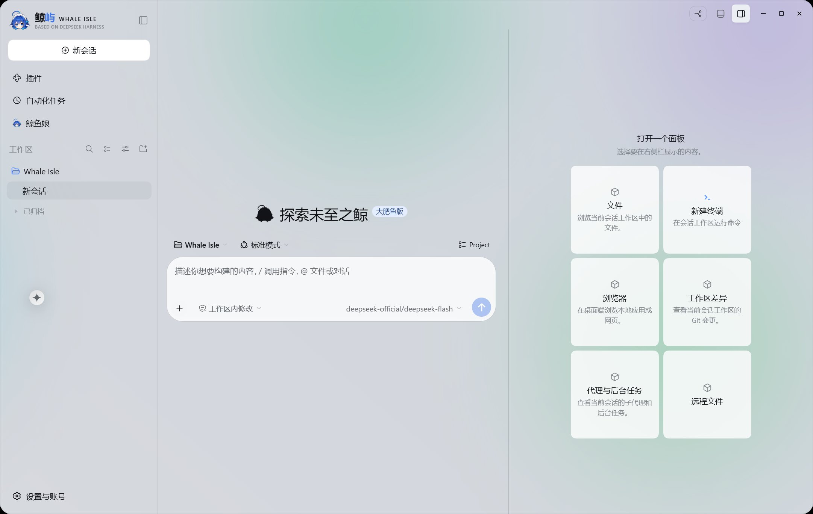
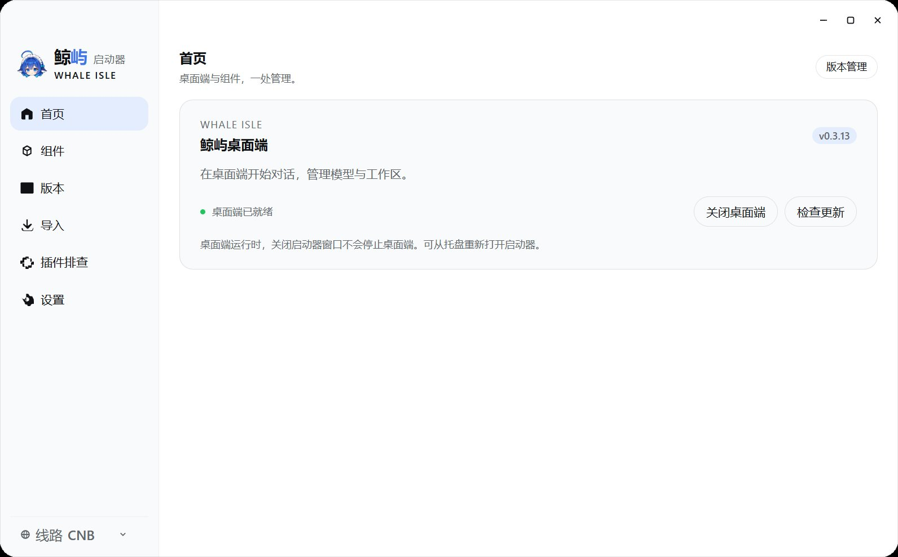

<p align="center">
  
</p>

<h1 align="center">鲸屿 Whale Isle</h1>

<p align="center">
  基于 DeepSeek Harness 的开源社区客户端<br />
  AI 对话、文件预览、终端与 Git，一个窗口完成。
</p>

<p align="center">
  中文 · <a href="README.en.md">English</a> ·
  <a href="https://github.com/ChisaAlter/WhaleIsle/releases/tag/v0.3.13">更新说明</a> ·
  <a href="https://github.com/ChisaAlter/WhaleIsle/issues">反馈</a>
</p>

<p align="center">
  <a href="https://github.com/ChisaAlter/WhaleIsle/releases/latest"></a>
  <a href="LICENSE"></a>
  
  
  
</p>

<p align="center">
  
</p>

社区独立维护，非 DeepSeek 官方产品。

## 下载 v0.3.13

| 平台 | GitHub | 国内镜像 |
| --- | --- | --- |
| Windows 10+ · x64 | [安装包](https://github.com/ChisaAlter/WhaleIsle/releases/download/v0.3.13/Whale-Isle-Setup-0.3.13.exe) | [CNB](https://cnb.cool/ayasealter/WhaleIsle/-/releases/download/v0.3.13/Whale-Isle-Setup-0.3.13.exe) |
| macOS 14+ · Apple Silicon | [ARM64 DMG](https://github.com/ChisaAlter/WhaleIsle/releases/download/v0.3.13/Whale-Isle-0.3.13-mac-arm64.dmg) | [CNB](https://cnb.cool/ayasealter/WhaleIsle/-/releases/download/v0.3.13/Whale-Isle-0.3.13-mac-arm64.dmg) |
| Android 8.0+ | [APK](https://github.com/ChisaAlter/WhaleIsle/releases/download/android-v0.3.11/Whale-Isle-0.3.11-android.apk) | [CNB](https://cnb.cool/ayasealter/WhaleIsle/-/releases/download/android-v0.3.11/Whale-Isle-0.3.11-android.apk) |

桌面安装包未签名，Mac 首次打开需右键「打开」；Android 独立发布。各发布页附 SHA512 校验清单。

## 快速开始

1. 安装桌面端，在「设置 → 模型」配置 API 服务（费用由模型服务商收取）。
2. 选择工作目录，或直接新建会话。
3. 手机安装 Android 客户端，扫描桌面「远程」二维码连接。

## 功能

- **对话与协作**：工具调用、审批、Agent 团队与 Project。
- **文件与开发**：文件编辑、网页与 Diff 预览、终端、Git。
- **实时面板**：悬浮面板，可用命令、HTTP 或 AI 持续刷新。
- **扩展**：MCP、技能、插件市场；Windows 可安装[鲸桥](docs/features/launcher-components.md)。
- **外观与用量**：Codex / Claude 皮肤、壁纸、Live2D 鲸鱼娘、Token 与费用统计。

<table>
  <tr><th>启动器</th><th>Android 连接页</th></tr>
  <tr>
    <td align="center"></td>
    <td align="center"></td>
  </tr>
</table>

## 从源码运行

需要 Git 和 Node.js 22.19+ 或 24+（CI 版本见 [.nvmrc](.nvmrc)）。运行前先退出安装版及托盘，两者共用单实例锁。

```shell
git clone https://github.com/ChisaAlter/WhaleIsle.git
cd WhaleIsle
npm ci
npm run setup:harness
npm start
```

## 数据与文档

数据保存在 Windows `%APPDATA%\Deepseek-Harness-Desktop` 或 macOS `~/Library/Application Support/Deepseek-Harness-Desktop`，覆盖安装会保留。

[产品手册](docs/handbook/README.md) · [开发文档](docs/maintenance/README.md) · [贡献指南](CONTRIBUTING.md) · [反馈问题](https://github.com/ChisaAlter/WhaleIsle/issues/new/choose)

<p align="center">
  
</p>

感谢 [DeepSeek Harness](https://github.com/deepseek-ai/deepseek-harness)、[yetone / Magpie](https://github.com/yetone/magpie) 与 [Linux.do](https://linux.do) 社区。· [MIT](LICENSE)
