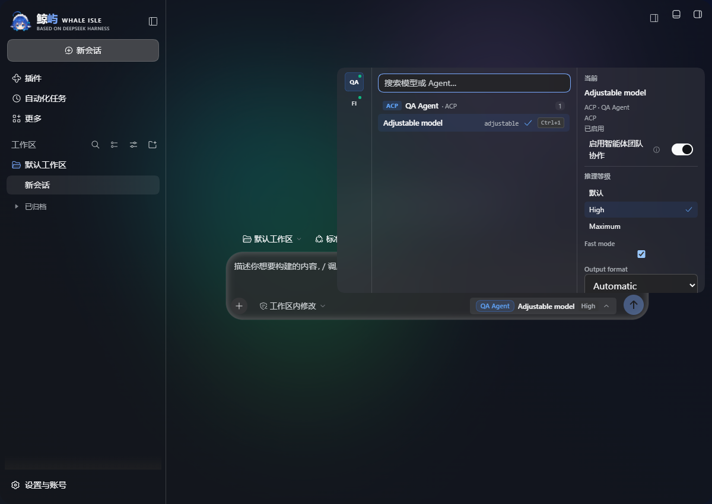
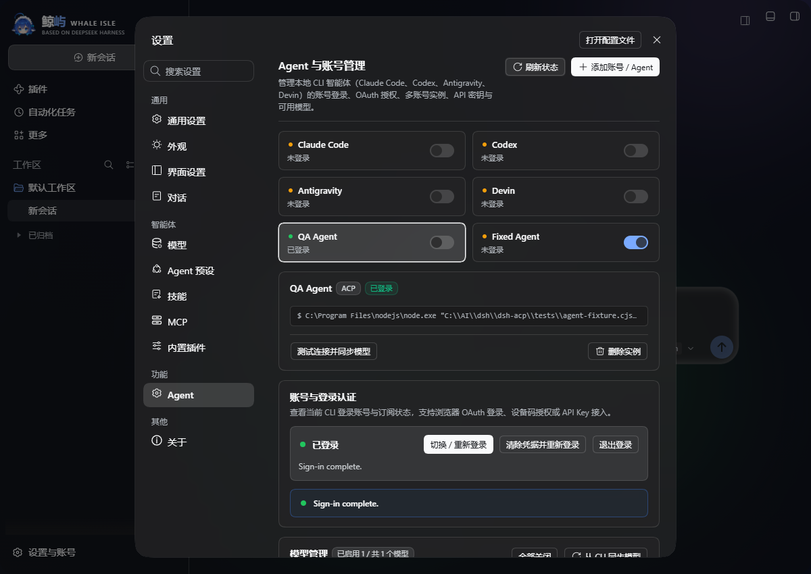

# DSH ACP Agents

[简体中文](README.md) · [English](README.en.md)

**Bring your coding agents into DeepSeek Harness and Whale Isle—for direct conversations and managed subagent collaboration.**

Connect Claude Code, OpenAI Codex, Google Antigravity, Cognition Devin, and other services compatible with the [Agent Client Protocol (ACP)](https://agentclientprotocol.com/). Manage accounts, models, and runtime settings in **Settings → Agent**, then use the Agent-first picker at the bottom of the conversation to choose an Agent, model, and reasoning level.

[Releases & downloads](https://github.com/ChisaAlter/dsh-acp-agents/releases) · [Report an issue](https://github.com/ChisaAlter/dsh-acp-agents/issues) · [License](LICENSE)

## What you can do

- **Switch Agents within one conversation.** Keep the host conversation identity, hand visible context to the selected Agent, and return to its existing ACP session later.
- **Delegate work to other Agents.** Start independent child sessions through tools and receive results automatically when they finish.
- **Join Agent Teams.** Configured Agents can lead or join a team and share the host task board with native members.
- **Follow background work.** See recent activity, active tools, pending questions or approvals, and actual completion, failure, or cancellation outcomes.
- **Manage multiple accounts.** Create several instances of the same Agent with separate account directories, environment variables, and model settings.

This repository is an independent Cordis plugin with a bundled ACP runtime. It does not include the Whale Isle or DeepSeek Harness host.

## Screenshots

### Choose an Agent, model, and reasoning level in one place

Switch Agents on the left, search and select models in the center, and adjust advertised reasoning options on the right. The host's native Team control remains available. Narrow windows use a stacked layout.



### Disable an Agent without signing out

Manage instances and accounts in **Settings → Agent**. In this screenshot, QA Agent is disabled but remains signed in. Refreshing or reenabling it does not sign the account out.



These screenshots show version 0.4.8 running in Whale Isle with synthetic test Agents. The interface language is Simplified Chinese.

## What's new in 0.4.9

- Browsing another Agent or model previews its own reasoning levels and session options without borrowing the current Agent's values. Browsing does not change the conversation route; select the model before editing options such as Multitask.
- Selecting a model keeps the menu open so reasoning and session options can be adjusted immediately.
- Reserved space for effort labels and save status keeps the composer controls steady. List navigation scrolls only the model list instead of moving the background.

### 0.4.8

- Restored the plugin's Agent-first picker, including model search, keyboard selection, dynamic session options, and native Team controls.
- Separated Agent availability from account authentication. Disabled Agents still read existing sign-in confirmation without starting an Agent process for status checks.
- Fixed a completed model-selection request closing a menu that had already been reopened, and improved the narrow-window layout.

## Install and get started

### 1. Install the plugin

Download a `.tgz` plugin package from [GitHub Releases](https://github.com/ChisaAlter/dsh-acp-agents/releases), then run this command in the download directory:

```sh
dsh plugin --profile web add "./dsh-acp-agents-<version>.tgz"
```

Replace `<version>` with the version of the downloaded file, and use the profile you actually run instead of `web` if needed. For a Whale Isle-managed profile, use the CLI bundled with Whale Isle. Exit the host normally before upgrading, then restart it after installation. Packages are distributed through GitHub, not the npm registry.

**To package the current source**, you can use the bundled runtime without rebuilding it first:

```sh
git clone https://github.com/ChisaAlter/dsh-acp-agents.git
cd dsh-acp-agents
npm pack
dsh plugin --profile web add ./dsh-acp-agents-0.4.9.tgz
```

The current source package version is **0.4.9**. Assets on the releases page correspond to their own tags.

### 2. Configure an account

1. Open **Settings → Agent** and add or select an instance.
2. Sign in, or enter the API credentials, command, and environment variables that Agent requires.
3. Test the connection, synchronize models, and enable the instance.
4. Return to the conversation and choose an Agent, model, and available reasoning level in the picker.

The Agent switch controls availability for model selection and task execution. Disabling or reenabling an Agent does not sign it out; confirmed sign-in survives refreshes and restarts. Use **Sign out** to sign out of an account.

Claude Code, Codex, and Antigravity support ACP Registry-managed distributions; Devin uses a local CLI. For other ACP services, configure a command, arguments, and environment variables. Terminal-based sign-in requires a host PTY service; other sign-in methods do not.

Ordinary sign-in first checks whether existing credentials can create a session, avoiding unnecessary authentication. Use **Switch / Sign in again** to change accounts. Opening a browser is not treated as success: authentication is confirmed by creating an actual ACP session. Cancellation and expiration release the sign-in process.

Models, reasoning levels, select and boolean options, and credential forms are discovered through ACP capabilities. Models that do not advertise reasoning options keep their own defaults; the plugin does not inject a setting such as `medium`. Explicit parameter selections are validated again before execution.

## Switch Agents within a conversation

Selecting another Agent does not create a new host conversation. On the first switch, the new Agent receives the visible conversation text. When you return to an existing Agent, the plugin supplies turns it missed while preserving its ACP session.

- Context handoff includes visible text and retained images, not another Agent's private reasoning or internal runtime state.
- Images are transferred as actual bytes after ACP image-capability negotiation. A known text-only route explicitly marks omitted images; an image path without completed capability negotiation produces an error. Files are passed as resource links, which the host may also project as readable saved paths.
- A native session restoration failure preserves the original mapping and reports the error rather than silently creating a replacement session.

Switching with conversation history also depends on the host's context-management support. See [Compatibility and requirements](#compatibility-and-requirements).

## Delegate work to subagents

The plugin registers tools for host models and exposes them to external Agents through a session-authenticated MCP bridge. A parent can delegate to other enabled Agents without switching its own model.

### Discover Agents and start a task

Call `acp_agents()` to obtain actual instance and model IDs, then call `acp_delegate`. For example, after discovering an instance named `codex`:

```json
{
  "agent": "codex",
  "description": "Review session cancellation",
  "prompt": "Read-only review of cancellation races in lib/acp-session.js. Do not modify files. Return concrete findings and line numbers.",
  "client_request_id": "review-session-cancel-1"
}
```

Subagents share the working directory by default but **do not inherit the parent conversation**. Include the goal, background, and permission scope in `prompt`. Before admission, the plugin checks the connection, authentication, model, and parameters. A preparation failure creates no child task. A prepared connection is reused, and preparation itself sends no task prompt.

An accepted task returns `taskId`, `subagentId`, `status: "running"`, and `next`. The parent follows `next` and ends its turn to wait. Results are delivered durably: a busy parent receives them at its next model step, while an idle parent is awakened automatically. The child does not need to send a second final report.

### Inspect, continue, or cancel a task

| Tool | Purpose |
| --- | --- |
| `acp_agents()` | List enabled Agent instances and models without exposing credentials. |
| `acp_delegate({ agent, prompt, ... })` | Start an independent task; asynchronous by default. |
| `acp_result({ task_id })` | Read the status and output of a specific task, including older tasks. |
| `send_message` | Add input to an existing child session; after its previous task ends, create a new execution entry. |
| `interrupt_agent` | Interrupt the current execution while retaining queued input. |
| `acp_cancel({ task_id })` | Cancel a task, clear queued input, wait for descendants and resources to release, and stop completion wakeups. Completed output remains readable. |

Use `acp_result` after a completion notification or when the user asks for status; do not poll running tasks. The compatibility parameter `agent_id` reads that child's latest task. Prefer `task_id` when you need an older result.

Both `acp_result.wait_ms` and delegation with `mode: "wait"` support event-driven waits of up to **20000 ms**. A wait timeout retains automatic completion notification. Retrying the same parameters with the same `client_request_id` does not start another task; changing the parameters for that ID produces an error.

### Optional parameters

- `cwd`: optional absolute target working directory (**required** when delegating from a `whale-girl` session to prevent landing in `data/whale/`). Must point to an existing regular directory; symlinks/junctions, Windows UNC/device paths, `$DSH_HOME` (default `~/.dsh`), `data/whale`, system/application credential directories (such as `%APPDATA%`, `%LOCALAPPDATA%`, `~/.config`, `~/.ssh`, `~/.aws`), user home directories, and filesystem roots are rejected.
- `model`, `reasoning_effort`: use actual IDs from discovery. If the model is omitted, the first visible configured model is used.
- `options: [{ "id": "…", "value": "…" }]`: supply advertised non-permission options, with string or boolean values.
- `isolation: "worktree"`: create an independent worktree from committed `HEAD` under `.agent-worktrees/` and return its retained path. This does not copy uncommitted changes, move files, or clean the parent workspace. The directory is added to the repository's `.git/info/exclude`. If pre-admission preparation fails, the unused orphan worktree is automatically cleaned up.
- `interaction_mode: "plan"`: restrict work to read-only investigation and planning.
- `runtime_mode`: `inherit`, `read-only`, or `approval-required`. Permissions can only be inherited or tightened relative to the host.
- `mode: "wait"`, `timeout_ms`: bounded waiting; asynchronous by default. The default wait is 15000 ms, with a maximum of 20000 ms.
- `name`: optional teammate name, 1–32 lowercase letters, digits, or hyphens; starts with a letter, is not `lead`, and is unique under the same parent.

### Background work does not block later output

Activity from a native background tool is reported separately while it runs. The host tool receipt is produced only after actual completion or failure. Later text and other completed tools do not have to wait for the first background command. Nested ACP text and error details are retained in tool results.

Task cards show the Agent, model, task, status, and elapsed time. Click one to open its existing child conversation. Until native turn accounting completes, token usage shows **Usage pending**, not a liveness verdict.

After **five minutes without native activity**, the card shows **No update for 5 min** and the parent receives one notification for that task. Pending user questions or approvals do not trigger it. New activity clears the marker. Inactivity does not cause the plugin to kill a process, retry, or create a duplicate task.

After a host restart, opening the parent conversation reconciles task status against child history and the durable inbox, then delivers missing results. Interrupted tasks show recovery diagnostics and resume only after explicit new input; the original prompt is not replayed automatically. Legacy entries without receipts still use historical logs for recovery display.

## Use Agent Teams

Enable **Use Agent Teams** in the root conversation's picker. The selection applies to the entire subagent tree, including configured ACP Agents.

1. The lead calls `team_task_create` with the goal, dependencies, and intended write scopes.
2. Create a named teammate through `acp_delegate`, including its task ID in the brief.
3. The teammate reads the board with `team_task_list` / `team_task_get`, claims a task with `team_task_update` using the current revision, and marks it complete when finished.
4. Use `send_message` when another member needs to act. A task-board update alone does not wake members; child completion notifies its parent automatically.

ACP and native members use the same host task board. Claim permissions, lead reassignment, and revision checks are enforced by the host under the actual caller identity. `write_scopes` communicate collaboration intent; they are not file locks. Parallel editors still need non-overlapping ownership.

With Team mode enabled, `list_agents` returns the whole team, names the root `lead`, uses returned path names for members, and marks the caller as `self`. `send_message` and `interrupt_agent` accept team names or session IDs; interruption remains limited to Agents created by the caller. With Team mode off, listing returns to direct children. Mounted Team tools may remain in the MCP tool list, but each call checks the switch and refuses task-board mutations when it is off.

A configured ACP lead can currently create configured ACP teammates. The `subagent` tool for creating native DSH-model teammates is not yet exposed to it.

## Permissions, data, and recovery

### The host controls permissions

Configuring an Agent grants no extra permissions. Tool receipt projection and ACP permission requests are separate; execution remains subject to the host sandbox and approval policy. Operations requiring confirmation use the root conversation's question interface. An explicit `never` policy rejects operations requiring approval. Pending approvals, questions, and interaction failures retain their specific states.

The Agent's own no-prompt mode, such as Antigravity `yolo`, is enabled only when the host uses both `danger-full-access` and approval `never`. Under `workspace-write`, sandbox checks still apply. Authentication, network, and model errors retain their actual cause; the plugin does not retry with weaker permissions.

Model-initiated external delegation (`acp_delegate`, as well as `send_message` when restarting a finished external child for a new execution turn) passes a main-process desktop confirmation gate over the loopback control channel (`DSH_DESKTOP_INSTALL_URL` and in-process secret `DSH_DESKTOP_INSTALL_TOKEN`). If the channel is absent, unreachable, or declined, the call fails closed and does not start the external Agent.

### Local storage

Data is stored under `$DSH_HOME`, or `~/.dsh` when it is unset:

| Path | Contents |
| --- | --- |
| `acp-agents.json` | Agent instances, models, and environment settings; may contain credentials. |
| `acp-agent-sessions.json` | Mappings between host sessions and external ACP sessions. |
| `acp-tasks.json` | Durable task receipts, including prompts, output, and retry identity. |
| `acp-profiles/` | Default account directories; explicit `profileDir` takes precedence. |
| `acp-runtime/` (or legacy `t3/`) | Managed downloaded Agent runtime binaries (`tools/`) and authentication status cache (`provider-status-cache/`). |
| `acp-error.log` | Redacted diagnostic log, rotated to `.1` at 1 MiB. |

Protect these files like conversation logs. Credentials are stored in local configuration; catalog responses mask secret-shaped values and retain unchanged values on save. On platforms supporting POSIX permissions, files are restricted to `0600` and plugin-owned account/cache directories to `0700`. Existing user-specified `profileDir` directories are not changed. Windows access control follows local directory permissions.

Upgrades retain instance IDs, `acp:<instance ID>` providers, account directories, session mappings, and existing runtime caches. Explicit `profileDir` overrides inherited or conflicting home variables. Without an explicit override, Antigravity continues using its existing instance directory and supports both newer `agy acp` and older server launch modes.

### Recover an unreadable store

A file that cannot be parsed or has an invalid structure is preserved as `<filename>.corrupt-<timestamp>`. The plugin then starts with an empty store so the next save cannot overwrite the original. **Settings → Agent** keeps showing the location of each preserved file, including after a restart.

Stop the host and back up the current file before repairing a preserved file and restoring its original name. The notice clears after the preserved file is restored or moved out of the directory. Task receipts are not deleted by count, so old results and idempotency identities remain available. Store reads do not delete temporary files by age; failed writes clean up only the temporary file they created.

## Compatibility and requirements

- Node.js `^22.19.0 || >=24.0.0`.
- A DeepSeek Harness / Whale Isle host providing Cordis 4, LLM adapter registration, connection, and Web services.
- Delegation additionally requires the host's `subagents`, `tools` (including `@deepseek-ai/dsh-tools`), managed local child-session interfaces, and the main-process desktop confirmation channel (`DSH_DESKTOP_INSTALL_URL` + in-process secret `DSH_DESKTOP_INSTALL_TOKEN`). On headless CLI/Web hosts without a desktop confirmation channel, `acp_delegate` fails closed while single-conversation Agent switching remains available.
- Agent Teams requires a host Team service. Windows terminal sign-in requires correct ConPTY disposal in the host; installing this plugin does not update the host PTY module.

**Standard DSH 0.2.2-rc.2:** the native settings entry and capability-driven reasoning options have been verified. Switching models with conversation history requires the paired [server context-ownership correction](tools/host-compat/README.md). The plugin package does not modify host modules automatically.

**DSH 0.2.2-rc.3:** the previously reported inability to select models still awaits runtime verification. Its published source contains a switching restriction for unknown context capacity; do not apply the rc.2 server correction to it.

Managed delegation supports the nested request shape from host subagent 0.2.1 and the flat shape from 0.2.2. It does not retry a delegation that may already have been accepted. Ordinary child listing, status, waiting, and continuation retain direct-parent permissions. MCP ownership follows the current execution's provider route.

## Development and verification

### Rebuild the client UI

Modular client sources live under `client-src/` and compile to `client/client.js` (published packages ship only runtime files and the built `client/client.js`, excluding `client-src/`, `tests/`, and upstream build sources). After editing client code, run:

```sh
npm ci --prefix tools/runtime-build
npm run build:client
npm run check:client
```

`check:client` verifies in memory that `client/client.js` matches `client-src/` without writing to disk.

### Rebuild the bundled runtime

Rebuild only when runtime source changes:

```sh
npm ci --prefix tools/runtime-build
npm run build:runtime
npm run check:runtime
```

`check:runtime` verifies in memory that `lib/vendor/agent-runtime.cjs` and `lib/vendor/mcp-bridge.cjs` match `tools/runtime-build/` byte-for-byte, and checks that `THIRD_PARTY_NOTICES.md` covers every statically bundled third-party package and its license. The runtime source snapshot, cherry-picked overlays, and local patches are recorded in `tools/runtime-build/upstream/SOURCE.json`. Builds do not depend on another project checkout or a T3 Code installation. The plugin owns account management, session routing, host collaboration, and UI. Adapted third-party code is isolated in the runtime directory; see [THIRD_PARTY_NOTICES.md](THIRD_PARTY_NOTICES.md) for sources and licenses.

### Verify the affected paths

```sh
npm test
```

Additional integration commands take a host path as needed:

| Command | Prerequisites and coverage |
| --- | --- |
| `npm run test:client` | Set `DSH_CLIENT_HOST_ROOT` to a supported host package directory containing `package.json`; checks real Cordis activation and client compatibility. |
| `npm run test:host` | Set `DSH_HARNESS_ROOT` to a built Harness with the development testkit; checks AgentLoop, child sessions, ACP processes, and the HTTP/MCP bridge. |
| `npm run test:team` | Uses the same `DSH_HARNESS_ROOT`, with `packages/team` built; checks the shared board and collaboration against production host dependencies without the development testkit. |
| `npm run test:installed-host` | Set `DSH_INSTALLED_HOST_ROOT` to the desktop installation's `resources/vendor/deepseek-harness`; checks delegation, background progress, switching, continuation, old results, cancellation, and quiet notifications in isolated sessions. |
| `npm run test:host-compat` | Set `DSH_COMPAT_HOST_PACKAGE` to a supported host CLI's `package.json`; checks server transformations, ordinary LLM capacity guards, unsupported versions, and preparation-directory cleanup without modifying the installed host. |

Ordinary integration uses scripted ACP services, with no paid model calls or real accounts. Real-account checks in `test:installed-host` require explicit `DSH_NATIVE_HOME` and `DSH_TEST_NATIVE_AGENT`, plus optional `DSH_TEST_NATIVE_MODEL`. They reuse the specified native account for a short response, do not start sign-in, and do not rewrite daily Agent, session-mapping, or task JSON files.

## License and acknowledgments

This project uses the [MIT License](LICENSE). The bundled runtime adapts code from [T3 Code](https://github.com/pingdotgg/t3code), retaining its copyright and license notices. Thanks also to ACP and the host ecosystem for the protocol and collaboration infrastructure.

Thanks to the [LINUX DO](https://linux.do/) community for its discussion and feedback.
