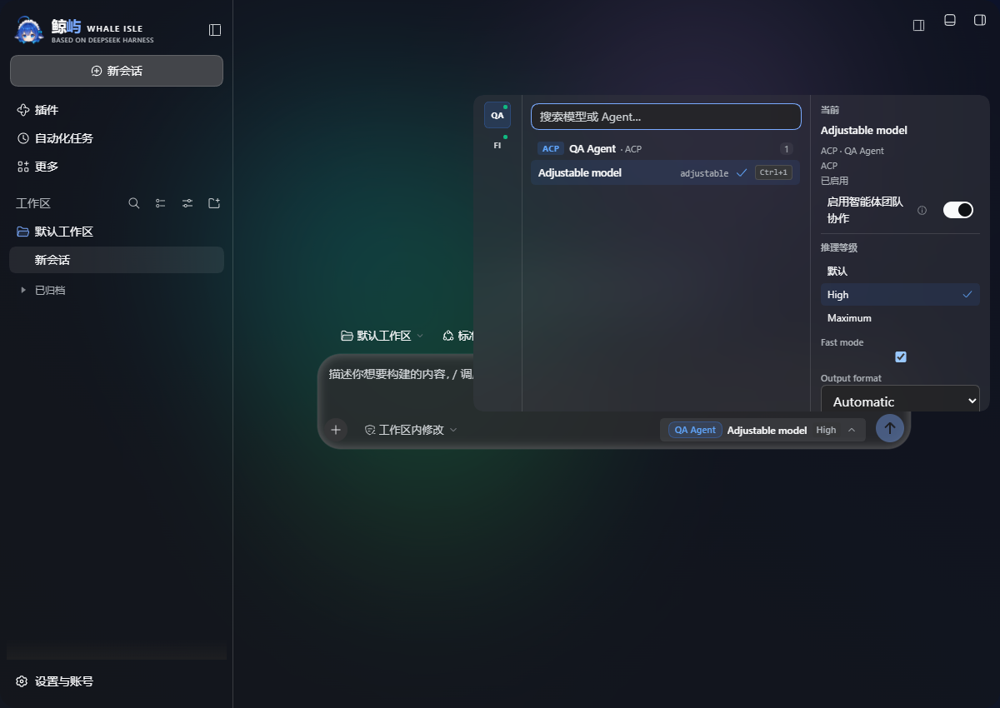
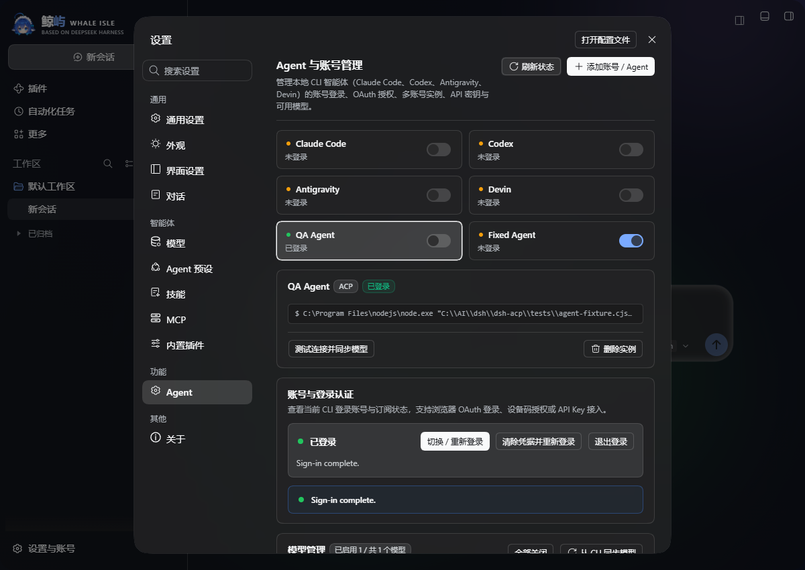

# DSH ACP Agents

[简体中文](README.md) · [English](README.en.md)

**把你常用的编程 Agent 接入 DeepSeek Harness 和 WhaleIsle（鲸屿）：既能直接聊天，也能作为子代理协作。**

支持 Claude Code、OpenAI Codex、Google Antigravity、Cognition Devin，以及其他兼容 [Agent Client Protocol（ACP）](https://agentclientprotocol.com/) 的服务。账号、模型和运行配置统一在 **设置 → Agent** 管理；会话底部使用 Agent 分栏选择器，集中切换 Agent、模型和推理等级。

[发布与下载](https://github.com/ChisaAlter/dsh-acp-agents/releases) · [问题反馈](https://github.com/ChisaAlter/dsh-acp-agents/issues) · [许可证](LICENSE)

## 可以做什么

- **在同一会话切换 Agent**：保留宿主会话身份，把可见上下文交给选中的 Agent；切回时继续使用它自己的 ACP 会话。
- **把任务交给其他 Agent**：父代理通过工具启动独立子会话，完成后自动收到结果，不必反复查询。
- **加入 Agent Teams**：配置好的 Agent 可以担任负责人或队友，与宿主原生成员使用同一块任务板。
- **看清后台任务状态**：展示最近活动、正在运行的工具、等待回答或审批，以及真实的完成、失败和取消结果。
- **分别管理多个账号**：同一种 Agent 可以创建多个实例，使用独立的账号目录、环境变量和模型配置。

本仓库是独立的 Cordis 插件，包含 ACP 运行时；不包含 WhaleIsle 或 DeepSeek Harness 宿主。

## 界面预览

### 在同一处选择 Agent、模型与推理等级

左侧切换 Agent，中间搜索与选择模型，右侧调整模型声明的推理选项，并保留宿主原生团队协作开关。窄窗口下自动改为上下排列。



### 关闭 Agent，账号仍保持登录

在 **设置 → Agent** 管理多个实例及账号。下图中 QA Agent 的启用开关已关闭，账号仍显示“已登录”；刷新或重新开启不会触发退出登录。



截图来自 0.4.8 在 WhaleIsle 中的实际运行，使用合成测试 Agent；界面语言为简体中文。

## 0.4.9 更新

- 浏览另一个 Agent 或模型时，右栏同步预览它自己的推理等级和会话选项，不再混用当前 Agent 的参数。浏览不会切换会话；选中模型后可修改 Multitask 等选项。
- 选中模型后菜单保持打开，可以直接继续设置推理强度，无需再次打开选择器。
- 为强度标签和保存状态保留稳定宽度，列表导航只滚动模型列表，避免调整参数时底部控件和背景跟着移动。

### 0.4.8

- 恢复插件的 Agent 分栏选择器，保留模型搜索、键盘选择、动态会话选项及原生团队协作控件。
- 将 Agent 启用状态与账号认证状态分离；关闭 Agent 时仍读取已有认证标记，不为查询状态启动已关闭的 Agent。
- 修复选模请求完成后误关闭已重新打开的菜单，并改善窄窗口布局。

## 安装与上手

### 1. 安装插件

从 [GitHub Releases](https://github.com/ChisaAlter/dsh-acp-agents/releases) 下载需要的 `.tgz` 插件包，在文件所在目录执行：

```sh
dsh plugin --profile web add "./dsh-acp-agents-<版本号>.tgz"
```

将 `<版本号>` 换成下载文件的实际版本；`web` 应与使用的 profile 一致。WhaleIsle 管理的 profile 请使用 WhaleIsle 随附的 CLI，并在更新前正常退出宿主，安装后重新启动。插件通过 GitHub 分发，不从 npm registry 安装。

**需要当前源码版本时**，可以直接打包，无需先重建随仓库附带的运行时：

```sh
git clone https://github.com/ChisaAlter/dsh-acp-agents.git
cd dsh-acp-agents
npm pack
dsh plugin --profile web add ./dsh-acp-agents-0.4.9.tgz
```

当前源码包版本为 **0.4.9**；发布页中的包以其对应标签为准。

### 2. 配置账号

1. 打开 **设置 → Agent**，添加或选择一个实例。
2. 完成登录，或填写该 Agent 需要的 API 凭据、命令和环境变量。
3. 测试连接并同步模型，启用该实例。
4. 回到会话，在分栏选择器中选择 Agent、模型和可用的推理强度。

Agent 开关只控制是否参与模型选择和任务执行；关闭或重新启用不会退出账号，已登录状态在刷新和重启后仍保留。退出账号请使用 **退出登录**。

Claude Code、Codex 和 Antigravity 支持使用 ACP Registry 托管发行版；Devin 使用本机 CLI。其他 ACP 服务可填写启动命令、参数和环境变量。终端式登录需要宿主提供 PTY；其他登录方式不依赖这一服务。

普通登录会先检查现有凭据能否创建会话，避免不必要地重新认证。需要换账号时使用 **切换 / 重新登录**。浏览器页面打开不代表登录成功，插件会以实际创建 ACP 会话的结果确认认证状态；取消或过期会释放本次登录进程。

模型、推理强度、下拉选项、布尔选项和凭据表单按 ACP 能力发现。未声明推理选项的模型使用自身默认值，不额外注入 `medium` 等设置；显式选择的参数会在执行前再次校验。

## 在会话中切换 Agent

选择另一个 Agent 不会新建宿主会话。首次切换时，新 Agent 收到可见对话文本；返回已有 Agent 时，插件补充它错过的轮次，并保留原有 ACP 会话。

- 上下文交接包含可见文本和保留的图片，不包含其他 Agent 的私有推理或内部运行状态。
- 图片在协商 ACP 图片能力后传递实际字节。已知仅支持文本时会明确标注省略；未完成能力协商的图片路径会报错。文件通过资源链接传递，宿主也可能将其投影成可读取的保存路径。
- 原生会话恢复失败时，保留原映射并报告具体错误，不悄悄新建替代会话。

带历史的会话切换还取决于宿主的上下文管理支持，见下方[兼容性说明](#兼容性与运行要求)。

## 把任务交给子代理

插件向宿主模型注册工具，也通过会话认证的 MCP 桥接将工具提供给外部 Agent。父代理不必切换自己的模型，就能委派其他已启用的 Agent。

### 发现并启动任务

先调用 `acp_agents()`，取得实际的实例 ID 和模型 ID，再调用 `acp_delegate`。例如，发现实例 ID 为 `codex` 后：

```json
{
  "agent": "codex",
  "description": "检查会话取消逻辑",
  "prompt": "只读检查 lib/acp-session.js 的取消竞态。不要修改文件，返回具体问题和行号。",
  "client_request_id": "review-session-cancel-1"
}
```

子代理默认共享工作目录，**不继承父会话内容**；请把必要的目标、背景和权限范围写进 `prompt`。启动前会检查连接、认证、模型和参数，准备失败不会创建子任务；通过检查的连接会直接复用，检查本身不发送任务提示词。

接受任务后返回 `taskId`、`subagentId`、`status: "running"` 和 `next`。父代理按 `next` 结束当前轮次等待即可：完成结果会持久化投递，父代理忙碌时在下一模型步骤收到，空闲时自动唤醒。子代理无需再发送一份最终报告。

### 查询、继续与取消

| 工具 | 用途 |
| --- | --- |
| `acp_agents()` | 列出已启用的 Agent 实例及模型，不返回凭据。 |
| `acp_delegate({ agent, prompt, ... })` | 启动独立子任务，默认异步返回。 |
| `acp_result({ task_id })` | 读取指定任务的状态和输出；早期任务结果仍可精确查询。 |
| `send_message` | 给已有子会话补充任务；上一任务结束后，记录新的执行条目。 |
| `interrupt_agent` | 中断当前执行，保留已排队的输入。 |
| `acp_cancel({ task_id })` | 取消任务、清空队列，等待后代及资源释放，并停止该任务的完成唤醒。已完成输出仍可读取。 |

完成通知到达后，或用户要求检查状态时，再使用 `acp_result`，不要轮询运行中的任务。兼容参数 `agent_id` 读取该子会话的最新任务；需要旧结果时优先使用 `task_id`。

`acp_result` 的 `wait_ms` 和委派的 `mode: "wait"` 都支持最长 **20000 ms** 的事件驱动等待；等待超时仍保留自动完成通知。使用同一个 `client_request_id` 重试相同委派参数不会重复启动任务，换成不同参数则会报错。

### 可选参数

- `cwd`：可选的绝对目标工作目录（从 `whale-girl` 会话委派时为**必填**，禁止隐式落入 `data/whale/`）。必须为已存在的普通目录，禁止符号链接/目录联接、Windows UNC/设备路径、`$DSH_HOME`（默认 `~/.dsh`）、`data/whale`、应用/系统配置与凭据目录（如 `%APPDATA%`、`%LOCALAPPDATA%`、`~/.config`、`~/.ssh`、`~/.aws` 等）、用户主目录及磁盘根目录。
- `model`、`reasoning_effort`：使用发现结果中的实际 ID；省略模型时使用首个可见配置模型。
- `options: [{ "id": "…", "value": "…" }]`：传入模型实际声明的非权限选项，值支持字符串或布尔值。
- `isolation: "worktree"`：从已提交的 `HEAD` 创建独立工作树，放在 `.agent-worktrees/`，结果中返回保留路径。不会复制未提交改动，也不会移动或清理父工作区；该目录加入仓库的 `.git/info/exclude`。若准备阶段失败，会自动清理刚创建的未运行孤儿工作树。
- `interaction_mode: "plan"`：限制为只读调查和规划。
- `runtime_mode`：`inherit`、`read-only` 或 `approval-required`，只能继承或收紧宿主权限。
- `mode: "wait"`、`timeout_ms`：有界等待；默认异步返回，等待时默认 15000 ms，最大 20000 ms。
- `name`：可选队友名称，1–32 个小写字母、数字或连字符，以字母开头，不能为 `lead`，同一父代理下不重复。

### 后台运行不再挡住后续输出

原生后台工具仍在运行时，其活动状态单独上报；实际完成或失败后才生成宿主工具回执。后续文本和其他已完成工具不必等第一条后台命令结束。ACP 嵌套文本与错误详情会保留在工具结果中。

任务卡片显示 Agent、模型、任务、状态和耗时，点击可打开原有子会话。Token 用量在原生轮次结算前显示 **用量待结算**，不作为存活判断。

连续 **五分钟没有原生活动**时，卡片显示“**五分钟无更新**”，父代理收到该任务的一次提示；等待用户回答或审批不触发。新活动会清除静默标记。静默不等于死亡，插件不会因此自动杀进程、重试或创建重复任务。

宿主重启后，打开父会话会用子会话历史和持久收件箱对齐任务状态，补投未送达结果。中断任务会显示恢复诊断，只有显式追加消息才继续执行，不自动重放原提示词；旧版无回执条目仍使用历史日志恢复显示。

## 使用 Agent Teams

在根会话选择器中开启 **启用智能体团队协作（Use Agent Teams）**。这个选择对整棵子代理树生效，包括配置好的 ACP Agent。

1. 负责人通过 `team_task_create` 创建任务，填写目标、依赖与预期写入范围。
2. 通过 `acp_delegate` 创建具名队友，说明需要处理的任务 ID。
3. 队友使用 `team_task_list` / `team_task_get` 读取任务，按最新 revision 调用 `team_task_update` 认领，完成后更新为完成状态。
4. 需要其他成员行动时用 `send_message` 协调；单纯修改任务板不会唤醒成员，子任务完成会自动通知父代理。

ACP 与原生成员操作同一块宿主任务板。认领权限、负责人改派和 revision 校验由宿主以实际调用者身份执行。`write_scopes` 是协作提示，不是文件锁；并行编辑仍应划分不重叠的范围。

Team 开启时，`list_agents` 返回整队，根代理名为 `lead`，成员使用返回的路径名称，并标记调用者 `self`。`send_message` 和 `interrupt_agent` 接受队内名称或会话 ID，中断权限仍限于调用者创建的代理。Team 关闭时，列表回到直接子代理；已挂载的 Team 工具可能仍列在 MCP 工具列表中，但每次执行都会检查当前开关，关闭后拒绝修改任务板。

配置好的 ACP 负责人目前可创建配置好的 ACP 队友；尚未向其暴露创建原生 DSH 模型队友的 `subagent` 工具。

## 权限、数据与恢复

### 权限以宿主为准

配置一个 Agent 不会额外授予权限。工具回执投影与 ACP 权限请求相互独立，执行始终受当前宿主沙箱和审批策略约束。需要人工确认的操作通过根会话的问题界面处理；明确的 `never` 策略会拒绝需要确认的操作。等待回答、审批及问答失败均保留具体状态。

只有宿主为 `danger-full-access` 且审批为 `never` 时，才启用 Agent 自身的免提示模式，例如 Antigravity `yolo`；`workspace-write` 下仍通过沙箱检查。认证、网络或模型错误应按原错误处理，不能靠降低权限要求重试。

模型触发的外部委派（`acp_delegate`，以及向已结束的外部子代理追加新轮次执行的 `send_message`）默认经过主进程桌面确认门禁（通过回环地址 `DSH_DESKTOP_INSTALL_URL` 与进程内密钥 `DSH_DESKTOP_INSTALL_TOKEN` 验证）。通道未配置、不可达或用户拒绝时均按 fail-closed 拦截，不会绕过确认启动外部 Agent。

### 本地保存位置

数据位于 `$DSH_HOME`，未设置时使用 `~/.dsh`：

| 路径 | 内容 |
| --- | --- |
| `acp-agents.json` | Agent 实例、模型及环境变量配置，可能包含凭据。 |
| `acp-agent-sessions.json` | 宿主会话与外部 ACP 会话的映射。 |
| `acp-tasks.json` | 持久任务回执，包含提示词、输出和安全重试身份。 |
| `acp-profiles/` | 默认账号目录；显式 `profileDir` 优先。 |
| `acp-runtime/`（兼容旧版 `t3/`） | 托管下载的 Agent 运行时二进制（`tools/`）与认证状态缓存（`provider-status-cache/`）。 |
| `acp-error.log` | 脱敏诊断日志，达到 1 MiB 后轮换至 `.1`。 |

这些文件应与会话日志一样妥善保护。凭据保存在本地配置中，目录接口会遮蔽密钥形态的值，并在未修改时保留原值。支持 POSIX 权限的平台将文件限制为 `0600`、插件自有账号和缓存目录限制为 `0700`；用户指定的已有 `profileDir` 不改权限。Windows 访问控制由本机目录权限决定。

升级保留实例 ID、`acp:<实例 ID>` provider、账号目录、会话映射及现有运行时缓存。显式 `profileDir` 优先于继承或冲突的 home 环境变量；Antigravity 无显式覆盖时继续使用原有实例目录，支持较新的 `agy acp` 与旧版服务启动方式。

### 配置损坏时怎么办

无法解析或结构不符合预期的存储文件会保全为 `<文件名>.corrupt-<时间戳>`，随后从空存储启动，避免下一次保存覆盖原数据。**设置 → Agent** 会持续显示每份保全文件的位置，重启后仍可见。

先停止宿主，备份当前文件，再修复保全文件并恢复原名；保全文件恢复或移出原目录后，相应提示才会消失。任务回执不会按数量自动删除，旧结果和幂等身份持续保留。读取存储不会按年龄删除临时文件，写入失败只清理本次写入创建的临时文件。

## 兼容性与运行要求

- Node.js `^22.19.0 || >=24.0.0`。
- DeepSeek Harness / WhaleIsle 宿主，提供 Cordis 4、LLM 适配器注册、连接和 Web 服务。
- 子代理委派还需要宿主的 `subagents`、`tools`（含 `@deepseek-ai/dsh-tools`）、受管理本地子会话接口，以及主进程桌面确认通道（`DSH_DESKTOP_INSTALL_URL` + 进程内密钥 `DSH_DESKTOP_INSTALL_TOKEN`）；无桌面确认通道的纯 CLI/Web 宿主上 `acp_delegate` 会默认 fail-closed 拒绝，但单会话 Agent 切换不受影响。
- Agent Teams 需要宿主挂载 Team 服务。Windows 终端登录需要宿主正确释放 ConPTY，单独安装插件不会更新宿主 PTY 模块。

**标准 DSH 0.2.2-rc.2**：已验证原生设置入口和能力驱动的推理选项。带历史的模型切换需要配套的[服务端上下文归属修正](tools/host-compat/README.md)；插件包不会自动修改宿主模块。

**DSH 0.2.2-rc.3**：此前报告的模型无法选择问题仍待运行验证；其发布源码含未知上下文容量的切换限制，不能套用 rc.2 的服务端修正。

受管理委派兼容宿主 subagent 0.2.1 的嵌套请求和 0.2.2 的扁平请求；不会用重试掩盖可能已接受的委派。普通子任务的列表、状态、等待和追加消息保持直接父子权限，MCP 所有权随当前执行的 provider 路由更新。

## 开发与验证

### 重建客户端界面

前端模块化源码位于 `client-src/`，构建产物输出至 `client/client.js`（打包发布时仅包含编译后的 `client/client.js` 与运行时文件，不包含 `client-src/`、`tests/` 或上游构建源码）。修改前端源码后运行：

```sh
npm ci --prefix tools/runtime-build
npm run build:client
npm run check:client
```

`check:client` 会在内存中比对 `client-src/` 与 `client/client.js` 是否一致，不写入磁盘。

### 重建内置运行时

只有修改运行时源码时才需要重建：

```sh
npm ci --prefix tools/runtime-build
npm run build:runtime
npm run check:runtime
```

`check:runtime` 会在内存中校验 `lib/vendor/agent-runtime.cjs`、`lib/vendor/mcp-bridge.cjs` 与 `tools/runtime-build/` 是否字节一致，并自动检查 `THIRD_PARTY_NOTICES.md` 是否完整涵盖全部静态打包的第三方依赖及其许可证。运行时源快照、cherry-pick 覆盖和本地补丁记录在 `tools/runtime-build/upstream/SOURCE.json`；构建不依赖其他项目检出或 T3 Code 安装。插件负责账号管理、会话路由、宿主协作及界面，第三方改编代码隔离在运行时目录，来源与许可见 [THIRD_PARTY_NOTICES.md](THIRD_PARTY_NOTICES.md)。

### 按改动范围验证

```sh
npm test
```

其余集成入口按需要提供宿主路径：

| 命令 | 前置条件与覆盖范围 |
| --- | --- |
| `npm run test:client` | `DSH_CLIENT_HOST_ROOT` 指向受支持宿主中包含 `package.json` 的包目录；验证真实 Cordis 激活和客户端兼容。 |
| `npm run test:host` | `DSH_HARNESS_ROOT` 指向已构建且含开发 testkit 的 Harness；验证 AgentLoop、子会话、ACP 进程与 HTTP/MCP 桥接。 |
| `npm run test:team` | 同一 `DSH_HARNESS_ROOT`，需构建 `packages/team`；使用生产宿主依赖验证共享任务板和成员协作，不需要开发 testkit。 |
| `npm run test:installed-host` | `DSH_INSTALLED_HOST_ROOT` 指向桌面安装的 `resources/vendor/deepseek-harness`；在隔离会话中验证委派、后台进度、切换、追加消息、旧结果、取消和静默通知。 |
| `npm run test:host-compat` | `DSH_COMPAT_HOST_PACKAGE` 指向受支持宿主 CLI 的 `package.json`；验证服务端变换、普通 LLM 容量保护、版本拒绝与准备目录清理，不修改已安装宿主。 |

常规集成使用脚本 ACP 服务，不消耗付费模型或使用真实账号。`test:installed-host` 的真实账号检查需显式设置 `DSH_NATIVE_HOME`、`DSH_TEST_NATIVE_AGENT`，可选 `DSH_TEST_NATIVE_MODEL`；它复用指定原生账号做简短回复，不发起登录，也不改写日用 Agent、会话映射或任务 JSON。

## 许可证与致谢

本项目采用 [MIT License](LICENSE)。内置运行时改编自 [T3 Code](https://github.com/pingdotgg/t3code)，保留其版权与许可声明；也感谢 ACP 及宿主生态提供的协议和协作基础。

感谢 [LINUX DO（L站）](https://linux.do/) 社区的交流与分享。
